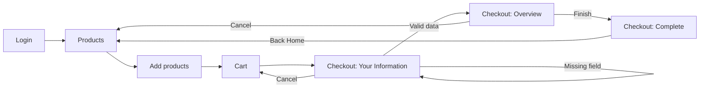

# Phase 4 Notes — Complete Checkout End-to-End Automation

## Chapter 1 — Checkout Testing Introduction

Checkout testing verify karta hai ki selected products cart se customer-information,
order overview aur confirmation tak correctly travel karte hain. Ye business-critical hai
kyunki product discovery successful hone ke baad bhi checkout fail hua toh order complete
nahi hoga.

- **Positive testing:** valid customer data ke saath supported journey complete karna.
- **Negative testing:** required fields blank rakhkar exact validation verify karna.
- **Functional testing:** har control aur business rule expected output deta hai ya nahi.
- **End-to-end testing:** login se order confirmation aur inventory return tak complete flow.
- **Regression testing:** new checkout code ke baad login, products aur cart behavior unchanged hai.

SauceDemo real payment gateway use nahi karta. Phase 4 sirf public demo transaction complete
karta hai; real money ya payment information send nahi hoti.

## Chapter 2 — Complete Checkout Architecture



- **Login:** standard demo user ko authenticated inventory session deta hai.
- **Products:** product identity, price aur Add/Remove state ka source hai.
- **Cart:** selected items aur cart prices verify karne ka checkpoint hai.
- **Information:** first name, last name aur postal code required hain.
- **Overview:** items, quantities, prices, subtotal, tax aur final total display karta hai.
- **Complete:** demo order confirmation show karta hai aur cart clear karta hai.

Verified URLs:

| Page | URL |
| --- | --- |
| Inventory | `https://www.saucedemo.com/inventory.html` |
| Cart | `https://www.saucedemo.com/cart.html` |
| Information | `https://www.saucedemo.com/checkout-step-one.html` |
| Overview | `https://www.saucedemo.com/checkout-step-two.html` |
| Complete | `https://www.saucedemo.com/checkout-complete.html` |

## Chapter 3 — Selenium Checkout Locators

Live DOM se verified locators:

```java
By.id("first-name");
By.id("last-name");
By.id("postal-code");
By.cssSelector("[data-test='checkout']");
By.cssSelector("[data-test='continue']");
By.cssSelector("[data-test='checkout-summary-container']");
By.cssSelector("[data-test='subtotal-label']");
By.cssSelector("[data-test='tax-label']");
By.cssSelector("[data-test='total-label']");
By.cssSelector("[data-test='finish']");
By.cssSelector("[data-test='complete-header']");
```

Product ko position se nahi, identity se locate kiya gaya:

```java
By.xpath("//div[@data-test='inventory-item']"
        + "[.//*[@data-test='inventory-item-name' and normalize-space()='"
        + productName + "']]");
```

- `By.id` unique form controls ke liye concise hai.
- `By.cssSelector` stable `data-test` attributes ke liye readable hai.
- Relative `By.xpath` named product ke containing card ko locate karta hai.
- `WebElement` current DOM element ka Selenium representation hai.
- `findElement()` first match return karta hai; no match par exception.
- `findElements()` list return karta hai; no match par empty list.

## Chapter 4 — Form Automation

```java
driver.findElement(FIRST_NAME_INPUT).sendKeys("Test");
driver.findElement(LAST_NAME_INPUT).sendKeys("User");
driver.findElement(POSTAL_CODE_INPUT).sendKeys("201310");
wait.until(ExpectedConditions.elementToBeClickable(CONTINUE_BUTTON)).click();
```

`sendKeys()` user typing simulate karta hai. `clear()` existing value remove karta hai when
a test explicitly edits a field. `click()` native WebDriver interaction hai. Phase 4 JavaScript
click use nahi karta.

Negative test example:

```java
submitCheckoutInformation("Test", "", "201310");
WebElement error = wait.until(
        ExpectedConditions.visibilityOfElementLocated(FORM_ERROR));
Assert.assertEquals(error.getText(), "Error: Last Name is required");
```

Verified errors:

- `Error: First Name is required`
- `Error: Last Name is required`
- `Error: Postal Code is required`

Expected aur actual exact compare karna accidental wording changes detect karta hai.

## Chapter 5 — Java BigDecimal

`double` binary floating-point hai, isliye decimal money exact represent nahi kar sakta.
`BigDecimal` String se create karne par exact decimal preserve karta hai.

### Example 1 — Price creation

```java
BigDecimal price = new BigDecimal("29.99");
```

### Example 2 — UI price parsing

```java
BigDecimal price = new BigDecimal("$29.99".replaceAll("[^0-9.-]", ""));
```

### Example 3 — Addition

```java
BigDecimal subtotal = new BigDecimal("39.98");
BigDecimal tax = new BigDecimal("3.20");
BigDecimal total = subtotal.add(tax); // 43.18
```

### Example 4 — Quantity multiplication

```java
BigDecimal unitPrice = new BigDecimal("9.99");
BigDecimal quantity = BigDecimal.valueOf(2);
BigDecimal lineTotal = unitPrice.multiply(quantity); // 19.98
```

### Example 5 — Numeric comparison

```java
BigDecimal first = new BigDecimal("10.0");
BigDecimal second = new BigDecimal("10.00");
Assert.assertEquals(first.compareTo(second), 0);
```

`equals()` value plus scale compare karta hai, so `10.0` and `10.00` unequal ho sakte
hain. `compareTo()` numeric magnitude compare karta hai and equality par `0` deta hai.
Currency scale normally two digits hoti hai, lekin displayed values compare karte waqt
`compareTo()` unnecessary scale mismatch avoid karta hai. Rounding invent nahi ki gayi;
tests displayed tax ko use karke exact displayed total validate karte hain.

## Chapter 6 — Collections and Mapping

```java
List<String> products = new ArrayList<>();
products.add("Sauce Labs Backpack");

Set<String> uniqueProducts = new LinkedHashSet<>(products);

Map<String, BigDecimal> prices = new LinkedHashMap<>();
prices.put("Sauce Labs Backpack", new BigDecimal("29.99"));

for (Map.Entry<String, BigDecimal> entry : prices.entrySet()) {
    System.out.println(entry.getKey() + " = " + entry.getValue());
}
```

- `List` ordered values aur duplicate detection support karta hai.
- `ArrayList` resizable `List` implementation hai.
- `Set` uniqueness aur order-independent membership comparison ke liye useful hai.
- `Map` product identity ko correct price se associate karta hai.
- `LinkedHashMap` readable deterministic insertion order preserve karta hai.
- Enhanced loop each element ko beginner-friendly way mein process karta hai.

Index-based price matching avoid hua because UI order change ho sakta hai. Product name
business identity hai, isliye `Map<String, BigDecimal>` safer hai.

## Chapter 7 — Checkout Overview Validation

1. Selected names ka exact set overview names se compare hota hai.
2. List size bhi compare hoti hai, so duplicate/unrelated item detect hota hai.
3. Cart and overview prices name-keyed maps se compare hote hain.
4. Each item subtotal: `unitPrice.multiply(quantity)`.
5. All line totals `BigDecimal.add()` se sum hote hain.
6. Displayed total: `displayedSubtotal.add(displayedTax)` se verify hota hai.

Real observed single-product example:

```text
Backpack: 1 × $29.99 = $29.99
Displayed tax: $2.40
Expected total: $29.99 + $2.40 = $32.39
Displayed total: $32.39
```

Tax percentage hardcode nahi hai because prompt mein fixed tax rate documented business rule
nahi tha. Test displayed tax and arithmetic consistency validate karta hai.

## Chapter 8 — Full E2E Selenium Test

`completePurchaseJourneyShouldPreserveDataAndFinishOrder` ka flow:

1. `@BeforeMethod` Chrome open karke public standard user login karta hai.
2. Inventory URL and visible container verify hote hain.
3. Backpack and Bike Light ki inventory prices map mein capture hoti hain.
4. Both named cards ke Add controls click hote hain.
5. Badge exactly `2` wait and assert hota hai.
6. Cart open karke exact product set verify hota hai.
7. Cart prices inventory map se product-name basis par compare hoti hain.
8. Checkout information form mein test-only data enter hota hai.
9. Overview names and prices cart state se compare hote hain.
10. Quantity × unit-price subtotal calculate hota hai.
11. Subtotal + displayed tax = displayed total verify hota hai.
12. Finish click ke baad exact confirmation verify hota hai.
13. Back Home inventory return and cleared badge verify karta hai.
14. `@AfterMethod(alwaysRun = true)` success/failure dono cases mein `quit()` karta hai.

## Chapter 9 — TestNG

```java
@BeforeMethod
public void setUp() { /* fresh browser and login */ }

@Test(description = "TC_CHECKOUT_001 - Navigate from cart to checkout")
public void cartCheckoutShouldOpenCheckoutInformation() { /* assertions */ }

@AfterMethod(alwaysRun = true)
public void tearDown() { driver.quit(); }
```

- `@BeforeMethod`: every test ko isolated session deta hai.
- `@Test`: scenario discover and execute hota hai.
- `@AfterMethod(alwaysRun=true)`: failed test ke baad bhi cleanup.
- `Assert.assertEquals`: exact URL/text/collection compare.
- `Assert.assertTrue`: visible/enabled state.
- `Assert.assertFalse`: absent badge/summary state.

Targeted command:

```powershell
& $maven '-Dtest=CheckoutTest' test
```

## Chapter 10 — All 16 Test Cases

Common precondition: SauceDemo reachable, supported browser available, standard demo user valid.

| ID | Method | Purpose / steps | Expected result | Verified result |
| --- | --- | --- | --- | --- |
| TC_CHECKOUT_001 | `cartCheckoutShouldOpenCheckoutInformation` | Add Backpack, cart, Checkout | Information URL, heading, form | Passed in Edge; passed in latest targeted Chrome observation |
| TC_CHECKOUT_002 | `checkoutInformationFormShouldExposeRequiredControls` | Inspect three fields and controls | All visible/available | Passed in Edge and Chrome |
| TC_CHECKOUT_003 | `emptyFirstNameShouldShowRequiredError` | Last/postal only, Continue | Exact first-name error | Passed in Edge; Chrome interaction intermittently blocked |
| TC_CHECKOUT_004 | `emptyLastNameShouldShowRequiredError` | First/postal only | Exact last-name error | Passed in Edge and Chrome |
| TC_CHECKOUT_005 | `emptyPostalCodeShouldShowRequiredError` | First/last only | Exact postal error | Passed in Edge; Chrome interaction intermittently blocked |
| TC_CHECKOUT_006 | `emptyCheckoutFormShouldReportFirstNameFirst` | Submit empty form | First-name error first | Passed in Edge; Chrome interaction intermittently blocked |
| TC_CHECKOUT_007 | `validCheckoutInformationShouldOpenOverview` | Valid demo data | Overview URL/heading/container | Passed in Edge; Chrome interaction intermittently blocked |
| TC_CHECKOUT_008 | `overviewShouldContainExactlySelectedProducts` | Add two, compare exact set | Same two products only | Passed in Edge; Chrome interaction intermittently blocked |
| TC_CHECKOUT_009 | `overviewPricesShouldMatchCartPricesByProduct` | Map cart/overview prices | Each named price equal | Passed in Edge; Chrome interaction intermittently blocked |
| TC_CHECKOUT_010 | `displayedSubtotalShouldEqualQuantityTimesUnitPrice` | Calculate line totals | Calculated/displayed subtotal equal | Passed in Edge; Chrome interaction intermittently blocked |
| TC_CHECKOUT_011 | `displayedTotalShouldEqualSubtotalPlusTax` | Parse three totals | subtotal + tax = total | Passed in Edge; Chrome interaction intermittently blocked |
| TC_CHECKOUT_012 | `cancelingCheckoutInformationShouldReturnToCart` | Cancel information | Cart URL/item/badge retained | Passed in Edge and Chrome |
| TC_CHECKOUT_013 | `cancelingCheckoutOverviewShouldReturnToInventory` | Cancel overview | Inventory; cart retained | Passed in Edge; Chrome interaction intermittently blocked |
| TC_CHECKOUT_014 | `finishingCheckoutShouldShowOrderConfirmation` | Finish valid order | Exact confirmation | Passed in Edge; Chrome interaction intermittently blocked |
| TC_CHECKOUT_015 | `backHomeAfterCompletionShouldReturnToResetInventory` | Complete then Back Home | Inventory and empty cart | Passed in Edge; Chrome interaction intermittently blocked |
| TC_CHECKOUT_016 | `completePurchaseJourneyShouldPreserveDataAndFinishOrder` | Full two-product E2E | All states and totals consistent | Passed in Edge; Chrome interaction intermittently blocked |

The first Chrome targeted run produced 4 passes and 12 native-interaction timeouts; the
final targeted Chrome run produced 3 passes and 13 errors. The same final test logic produced
16/16 passes in Edge. Final `mvn clean test` and `mvn verify` both reported 49 total, 30 passed,
0 assertion failures, 19 errors, and 0 skipped, although failing methods varied. No test is
skipped or weakened.

## Chapter 11 — Interview Preparation

1. **E2E testing kya hai?** Multiple integrated pages/components ka real user workflow validate karna.
2. **Functional vs integration testing?** Functional behavior requirement check karta hai; integration components ke data handoff ko.
3. **Positive test?** Supported valid input se success path.
4. **Negative test?** Invalid/missing input se validation behavior.
5. **Checkout business-critical kyun?** Failure directly order conversion block karta hai.
6. **Fresh browser per test kyun?** State contamination aur execution-order dependency avoid hoti hai.
7. **`@BeforeMethod` ka role?** Each TestNG method se pehle isolated setup.
8. **`alwaysRun=true` kyun?** Assertion/error ke baad bhi browser quit.
9. **CSS vs XPath?** Stable attributes ke liye CSS; relationship/text-based container ke liye XPath.
10. **`findElement` vs `findElements`?** One-or-exception vs list-or-empty.
11. **Explicit wait kya hai?** Specific observable state ko bounded polling se wait karna.
12. **Implicit wait mix kyun nahi?** Combined timing unpredictable ho sakta hai.
13. **`Thread.sleep` kyun avoid?** State unaware, slow aur flaky.
14. **JavaScript click kyun avoid?** Real user interaction defects conceal kar sakta hai.
15. **BigDecimal kyun?** Exact decimal financial arithmetic.
16. **String constructor kyun?** Binary floating approximation avoid hoti hai.
17. **`equals` vs `compareTo`?** First scale-sensitive; second numeric magnitude.
18. **Price map kyun?** Product identity ke saath correct value pair hoti hai.
19. **Set kab use karein?** Ordering requirement na ho aur exact membership validate karni ho.
20. **List size bhi kyun compare?** Duplicate/unrelated rows catch karne ke liye.
21. **Tax percentage hardcode kyun nahi?** Documented business requirement nahi hai.
22. **Quantity selector assume kyun nahi?** SauceDemo configurable quantity provide nahi karta.
23. **Stale element ka cause?** React re-render ke baad old element detached ho jata hai.
24. **Cart-to-overview consistency kaise?** Names and `Map<String, BigDecimal>` compare.
25. **Failure diagnosis order?** URL, DOM, locator, element state, console/network, assertion data.
26. **Retry test failure ka solution hai?** Nahi; root cause hide ho sakta hai.
27. **Public test site limitation?** External deployment/network/browser behavior team control mein nahi.
28. **Assertion failure vs error?** Assertion expected mismatch; error setup/interaction/timeout exception.
29. **Regression suite ka purpose?** New work ke baad preserved behavior verify karna.
30. **Page Object abhi kyun nahi?** Phase scope simple direct tests hai; POM Phase 6 mein planned hai.

## Chapter 12 — Coding Practice

These are illustrative exercises; production implementation `CheckoutTest.java` mein hai.

### 1. Enter form details

```java
driver.findElement(By.id("first-name")).sendKeys("Test");
driver.findElement(By.id("last-name")).sendKeys("User");
driver.findElement(By.id("postal-code")).sendKeys("201310");
```

### 2. Validate required-field error

```java
driver.findElement(By.cssSelector("[data-test='continue']")).click();
Assert.assertEquals(driver.findElement(By.cssSelector("[data-test='error']")).getText(),
        "Error: First Name is required");
```

### 3. Extract cart prices

```java
Map<String, BigDecimal> prices = new LinkedHashMap<>();
for (WebElement item : driver.findElements(By.cssSelector("[data-test='inventory-item']"))) {
    String name = item.findElement(PRODUCT_NAME).getText();
    prices.put(name, parseMoney(item.findElement(PRODUCT_PRICE).getText()));
}
```

### 4. Calculate one line subtotal

```java
BigDecimal line = price.multiply(BigDecimal.valueOf(quantity));
```

### 5. Read quantity

```java
int quantity = Integer.parseInt(item.findElement(
        By.cssSelector("[data-test='item-quantity']")).getText());
```

### 6. Verify subtotal

```java
Assert.assertEquals(actualSubtotal.compareTo(expectedSubtotal), 0);
```

### 7. Verify total formula

```java
Assert.assertEquals(total.compareTo(subtotal.add(tax)), 0);
```

### 8. Compare cart and overview products

```java
Assert.assertEquals(new LinkedHashSet<>(overviewNames),
        new LinkedHashSet<>(cartNames));
```

### 9. Verify confirmation

```java
Assert.assertEquals(driver.findElement(
        By.cssSelector("[data-test='complete-header']")).getText(),
        "Thank you for your order!");
```

### 10. E2E checkout assignment solution outline

```java
login();
addProduct("Sauce Labs Backpack");
openCart();
beginCheckout();
enterInformation();
verifyOverviewTotals();
finishCheckout();
verifyConfirmation();
```

Har action ke baad correct URL/DOM state explicit wait karo; placeholder helpers ko real
stable locators and assertions se implement karo.

## Chapter 13 — Debugging Scenarios

### 1. TimeoutException

URL unchanged ho toh locator se pehle interaction outcome inspect karo. Current Chrome run
mein visible enabled buttons kabhi event handle nahi kar rahe the; retry se hide nahi kiya.

### 2. NoSuchElementException

Current URL and page heading check karo. Wrong page par correct locator bhi absent hoga.

### 3. StaleElementReferenceException

Navigation/re-render ke baad old `WebElement` reuse mat karo; locator se fresh element read karo.

### 4. Incorrect price comparison

Currency symbol remove karo, String-based `BigDecimal` use karo, `compareTo()` se numeric equality.

### 5. Cart mismatch

Fixed indexes avoid karo. Exact name set, list size aur name-price map log/compare karo.

### 6. Wrong error message

Fields ka actual entered state aur live DOM error text capture karo. Unsupported validation invent mat karo.

### 7. Unexpected navigation

Information Cancel cart par aur overview Cancel inventory par jata hai. Dono ko same expected URL mat do.

### 8. Intermittent UI failure

Screenshot, URL, DOM state, browser/driver versions aur console collect karo. Same logic another
supported browser mein run karke browser-specific signal identify karo. Blind retry, sleep ya JS click avoid karo.

## Chapter 14 — Final Revision

### Phase 4 summary

- 16 independent checkout scenarios.
- Required fields, valid navigation and both Cancel paths.
- Exact product and price consistency.
- Quantity-aware subtotal with `BigDecimal`.
- Displayed tax plus subtotal equals final total.
- Confirmation, Back Home and complete two-product E2E journey.

### Important methods

`prepareCart`, `beginCheckoutFromCart`, `submitCheckoutInformation`,
`reachCheckoutOverview`, `readDisplayedProductPrices`,
`calculateDisplayedItemsSubtotal`, `parseMoney`, `assertMoneyEquals`.

### Java concepts

Encapsulation through private helpers, constants, interfaces (`List`, `Map`, `Set`), concrete
collections, loops, methods, `BigDecimal`, immutability and value comparison.

### Selenium concepts

Stable locators, scoped lookup, native user actions, explicit waits, URL conditions, fresh
element queries, screenshot/DOM diagnosis and reliable `quit()` cleanup.

### Common interview traps

- Money ko `double` mein compare karna.
- Actual list ko sort karke same object se compare karna.
- Product prices indexes se pair karna.
- Tax rate assume karna.
- Retry/sleep se failure hide karna.
- `close()` ko full session cleanup samajhna.
- Tests ko execution order par depend karna.

### Cheat sheet

```text
Money: new BigDecimal(String)
Numeric equality: a.compareTo(b) == 0
Total: subtotal.add(tax)
Line total: price.multiply(quantity)
Exact products: set equality + list size
Wait: wait.until(ExpectedConditions...)
Cleanup: @AfterMethod(alwaysRun = true) + quit()
```

### Practice assignment

Three products select karke inventory, cart and overview name-price maps compare karo. Overview
quantity-aware subtotal calculate karo, displayed tax add karo, confirmation complete karo, aur
Back Home ke baad cart cleared verify karo. Fixed indexes, hardcoded totals, sleep aur retries use mat karo.
