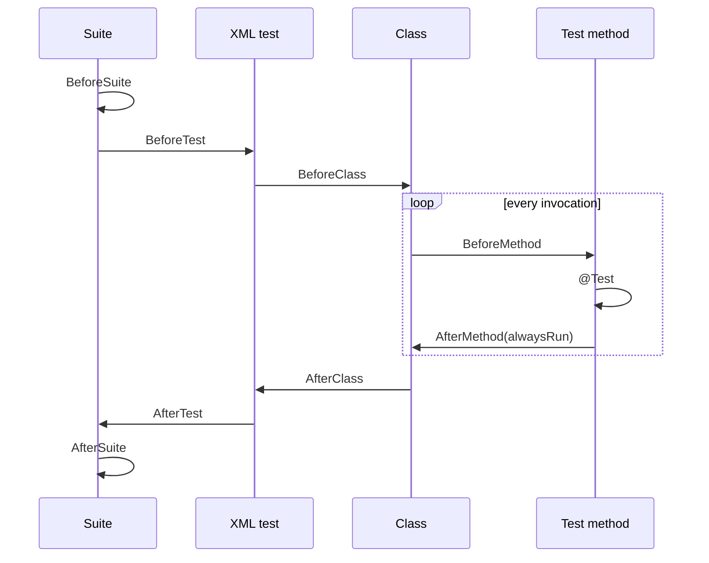

# Phase 5 — Professional TestNG + JUnit Framework (Hinglish Guide)

## 1. Testing framework kya hota hai?

Testing framework code, test data, execution rules, assertions aur reports ko ek predictable structure deta hai. Selenium browser ko control karta hai; TestNG/JUnit tests ko discover, schedule aur validate karte hain; Maven dependencies, compilation aur lifecycle manage karta hai; Surefire `test` phase mein tests chala kar XML reports banata hai.

Is project mein TestNG real SauceDemo UI/E2E tests ke liye primary framework hai. JUnit Jupiter ka isolated module fast Java unit-testing practice ke liye hai. Test method source-code unit hai; DataProvider/parameterized test ki har row ek alag executed invocation hoti hai.

## 2. TestNG basics

`@Test` method ko executable test banata hai. TestNG class instance banata, configuration methods chalata, test invoke karta aur assertion result report karta hai.

```java
@Test
public void titleShouldMatch() {
    Assert.assertEquals("Swag Labs", "Swag Labs");
}
```

TestNG browser tests ke liye useful hai because lifecycle, groups, XML suites, DataProvider aur dependencies built in hain. Project ka real example `LoginTest`; browser-free example `AssertionDemo` hai.

## 3. TestNG annotations and lifecycle

- `@BeforeSuite`/`@AfterSuite`: poori XML suite mein once.
- `@BeforeTest`/`@AfterTest`: XML ke har `<test>` block mein once. Ye Java `@Test` method nahi hai.
- `@BeforeClass`/`@AfterClass`: class mein once.
- `@BeforeMethod`/`@AfterMethod`: har test invocation ke around; DataProvider ki har row ke liye repeat.
- `alwaysRun=true`: selected group ya earlier failure ke bawajood essential configuration/cleanup chalane ki intent deta hai.



Superclass ka `@Before...` subclass se pehle aur superclass ka `@After...` subclass ke baad execute hota hai. Inheritance reuse ke liye useful hai, lekin hidden setup avoid karne ke liye hierarchy simple rakho. `LifecycleLearningExamples` do tests aur event/counter assertions se order demonstrate karta hai.

## 4. Assertions

Expected requirement hai; actual application/code se mila value hai. `Assert.assertEquals(actual, expected, message)` mismatch par `AssertionError` throw karta hai. Hard assertion current method turant rok deta hai. `SoftAssert` multiple checks collect karta hai, par `assertAll()` mandatory hai—iske bina collected failures result mein raise nahi honge.

```java
Assert.assertTrue(inventoryVisible, "Inventory should be visible");
SoftAssert softly = new SoftAssert();
softly.assertEquals(name, expectedName);
softly.assertEquals(price, expectedPrice);
softly.assertAll();
```

Login navigation jaisi gate condition par hard assertion best hai. Product card ke multiple independent fields par soft assertions useful ho sakti hain. Checkout total mismatch ke baad order complete karna unsafe hai, so hard assertion better hai. `AssertionDemo` equals/not-equals/true/false/null/not-null, controlled `Assert.fail`, and both SoftAssert paths cover karta hai; intentional failures contained aur expected hain, default build ko red nahi banate.

## 5. DataProvider

`@DataProvider` ek dataset source hai. `Object[][]` mein outer array rows/invocations aur inner array method arguments represent karta hai. Types/order test method signature se exactly match hone chahiye.

```java
@DataProvider(name = "loginData")
Object[][] data() {
  return new Object[][] {{"standard_user", "secret_sauce", true}};
}

@Test(dataProvider = "loginData")
void login(String user, String password, boolean success) { }
```

Implemented `DataDrivenLoginCases` line-by-line flow: `@BeforeMethod(alwaysRun=true)` fresh Chrome + wait create karta hai; factory password prompts disable karti hai; provider seven real cases return karta hai; parameters automatically inject hote hain; success branch URL + inventory assert karta hai; failure branch exact message + no inventory navigation assert karta hai; `@AfterMethod(alwaysRun=true)` every row ka browser quit karta hai. Password log nahi hota. Seven rows = one Java test method but seven report invocations. Multiple repeated `@Test` methods readable special cases ke liye theek hain; common flow + varying input ke liye DataProvider DRY hai.

## 6. Groups

Groups logical tags hain: `smoke`, `regression`, `login`, `products`, `cart`, `checkout`, `e2e`, `learning`. Class-level group all class test methods ko inherit hota hai; method-level group extra precise tag add karta hai. Smoke mein sirf five critical flows hain, every test nahi. XML `<include>` selected group run karta hai; `<exclude>` named group hata sakta hai. Existing UI setup `alwaysRun=true` hai so group filtering mandatory browser initialization skip nahi karti. Tests still independently runnable hain.

## 7. TestNG XML

XML execution selection ko Java code se separate karta hai.

```xml
<suite name="ShopFlow Smoke">
  <test name="Critical flows">
    <groups><run><include name="smoke"/></run></groups>
    <classes><class name="com.shopflow.tests.LoginTest"/></classes>
  </test>
</suite>
```

Project files: `testng-smoke.xml`, `testng-regression.xml`, `testng-login.xml`, `testng-products.xml`, `testng-cart.xml`, `testng-checkout.xml`, and `testng-learning.xml`. Maven Exec actual native TestNG main class ko test classpath aur selected `${testng.suite}` ke saath invokes karta hai. Is architecture ka reason: Surefire 3.6 unified JUnit Platform path mixed TestNG/JUnit classes run karta hai, but TestNG Platform engine custom TestNG XML suites support nahi karta; native TestNG runner XML semantics preserve karta hai.

## 8. Priority and dependency

Lower `priority` normally earlier schedule hota hai; same priority par order business contract nahi maana chahiye. `dependsOnMethods` dependent test ko prerequisite success ke baad chalata hai; prerequisite fail ho to dependent SKIP hota hai. Skip pass nahi hota. `ExecutionOrderLearningExamples` contained demo hai. Existing 49 UI tests mein dependencies nahi hain because production tests fresh state ke saath independently executable hone chahiye.

## 9. JUnit Jupiter

JUnit Jupiter modern JUnit programming model hai. `@BeforeAll`/`@AfterAll` once (default lifecycle mein static), `@BeforeEach`/`@AfterEach` har invocation, aur `@Test` regular unit test define karte hain. `assertThrows` error contract verify karta hai; `assertAll` grouped checks run karta hai.

```java
@Test
void rejectsNegativeQuantity() {
  assertThrows(IllegalArgumentException.class,
      () -> PriceCalculator.multiply(BigDecimal.TEN, -1));
}
```

`PriceCalculatorJupiterSpec` and `InputValidatorJupiterSpec` browser/network ke bina deterministic tests hain.

## 10. JUnit parameterized testing

- `@ValueSource`: single primitive/String argument values.
- `@CsvSource`: multiple columns inline.
- `@MethodSource`: objects/complex arguments ka stream.

```java
@ParameterizedTest
@CsvSource({"9.99, 2, 19.98", "12.50, 0, 0.00"})
void total(String price, int qty, String expected) { /* assert */ }
```

Implemented JUnit suite mein 8 Java test methods/containers hain, but sources expand them to 16 executed invocations: InputValidator 7 and PriceCalculator 9.

## 11. TestNG vs JUnit

| Topic | TestNG | JUnit Jupiter |
|---|---|---|
| Project role | Selenium UI/E2E primary | Java utility unit-learning |
| Parameter data | `@DataProvider` | `@ValueSource`, `@CsvSource`, `@MethodSource` |
| Grouping | Native groups + XML | Tags/suite mechanisms |
| Dependency | `dependsOnMethods` | Tests normally independent |
| Soft assertions | `SoftAssert` | `assertAll` executes grouped assertions |
| Lifecycle | Suite/Test/Class/Method | All/Each lifecycle |
| Speed here | Browser-bound | Millisecond, no browser |

Framework choice assertion quality decide nahi karta. UI tests slow integration behavior validate karte hain; unit tests small calculation/input contracts fast validate karte hain.

## 12. Maven execution

`clean` old `target` deletes; `test` compiles and Surefire executes; `verify` test ke baad package/verification lifecycle tak jata hai. Surefire default patterns original `*Test` classes discover karte hain. Learning/JUnit class names intentionally patterns se outside hain and explicit selection use karte hain.

```powershell
$maven = Join-Path $env:TEMP 'shopflow-maven-3.10.0\apache-maven-3.10.0\bin\mvn.cmd'
& $maven clean test
& $maven -DskipTests test-compile '-Dtestng.suite=testng-smoke.xml' exec:java
& $maven -DskipTests test-compile '-Dtestng.suite=testng-login.xml' exec:java
& $maven -DskipTests test-compile '-Dtestng.suite=testng-products.xml' exec:java
& $maven -DskipTests test-compile '-Dtestng.suite=testng-cart.xml' exec:java
& $maven -DskipTests test-compile '-Dtestng.suite=testng-checkout.xml' exec:java
& $maven -DskipTests test-compile '-Dtestng.suite=testng-regression.xml' exec:java
& $maven -DskipTests test-compile '-Dtestng.suite=testng-learning.xml' exec:java
& $maven '-Dtest=PriceCalculatorJupiterSpec,InputValidatorJupiterSpec' test
& $maven verify
```

Surefire XML `target/surefire-reports/TEST-*.xml` mein `tests`, `failures`, `errors`, `skipped` attributes audit karo. Native XML suites console/TestNG output dete hain. Separate commands ke counts ko unique scenarios ki tarah add mat karo.

## 13. Phase 5 code walkthrough

- `LifecycleLearningExamples`: every TestNG lifecycle scope and two invocation checks.
- `AssertionDemo`: hard/soft assertions; controlled failures expected/caught.
- `ExecutionOrderLearningExamples`: priority and one contained dependency.
- `DataDrivenLoginCases`: seven real SauceDemo datasets, exact errors, fresh protected Chrome profile.
- `PriceCalculator`: immutable static BigDecimal add/multiply/final-total/parse functions; validation encapsulated.
- `InputValidator`: null/blank predicate and guard clause.
- `PriceCalculatorJupiterSpec`: lifecycle, normal, exception, CSV and method-source tests.
- `InputValidatorJupiterSpec`: value-source valid/blank and null contracts.
- Seven XML files: critical, full, module, and learning selections.
- `pom.xml`: Jupiter and native TestNG XML runner; Java 17/Selenium/TestNG/Surefire versions preserved.

Java concepts: encapsulation through private constructors/helpers, immutability, static utility methods, exceptions, collections, streams, BigDecimal, and separation of concerns. Selenium concepts: fresh WebDriver, Selenium Manager, stable `By` locators, explicit waits, isolated profiles, reliable quit.

## 14. Interview questions (35)

1. **TestNG kya hai?** Java test framework with lifecycle, groups, parameterization and reporting.
2. **`@BeforeMethod` kab chalta hai?** Har `@Test` invocation se pehle, including each DataProvider row.
3. **`@BeforeClass` vs `@BeforeMethod`?** Class mein once vs every method/invocation.
4. **`@BeforeTest` ka “test” kya hai?** XML ka `<test>` block, Java method nahi.
5. **`@BeforeSuite` use?** Suite-wide one-time setup; WebDriver sharing ke liye usually avoid.
6. **`alwaysRun=true` kyun?** Essential setup/cleanup ko filtering/failure paths mein reliable banata hai.
7. **Hard assertion kya karti hai?** Failure par current method immediately stops.
8. **Soft assertion kya karti hai?** Checks collect karti hai until `assertAll()`.
9. **`assertAll()` bhool gaye to?** Collected SoftAssert failures raise nahi hongi: false pass risk.
10. **Actual vs expected order?** TestNG/JUnit APIs generally actual first, expected second; API check karo.
11. **DataProvider kya return kar sakta hai?** Commonly `Object[][]`; iterators also possible.
12. **One method, seven rows count?** Seven executed test invocations.
13. **DataProvider isolation kaise?** Per-invocation setup and teardown; shared mutable state avoid.
14. **Passwords log kyun nahi?** Reports/logs credentials leak kar sakte hain.
15. **Smoke suite kya hai?** Small critical health coverage with meaningful assertions.
16. **Regression suite kya hai?** Broader changed/unchanged behavior validation.
17. **Har test smoke kyun nahi?** Smoke fast signal lose karega aur full regression ban jayega.
18. **Group inheritance?** Class group methods ko applies; method can add more groups.
19. **Priority guarantee?** Scheduling hint; business state/order contract nahi banana chahiye.
20. **Dependency fail ho to?** Dependent test skipped.
21. **Skip aur pass difference?** Skip ne behavior validate nahi kiya; pass ne assertions complete ki.
22. **JUnit Jupiter kya hai?** JUnit 5+ programming/test engine model; here version 6.0.1 API/engine.
23. **`@BeforeAll` static kyun?** Default per-method instance lifecycle mein class instance available nahi hota.
24. **`assertThrows` kya validates?** Exact expected exception type from executable.
25. **JUnit `assertAll` SoftAssert hai?** Similar grouped reporting, but Jupiter executes supplied lambdas together.
26. **`@CsvSource` kab?** Small tabular primitive/String cases.
27. **`@MethodSource` kab?** Complex objects or reusable/generated arguments.
28. **BigDecimal money ke liye kyun?** Decimal arithmetic predictable; binary floating-point rounding avoid.
29. **Surefire role?** Maven test phase discovery, provider launch and reports.
30. **Provider conflict symptom?** One framework silently not discovered or zero tests.
31. **Is project mein coexistence kaise?** Surefire JUnit Platform + auto TestNG engine; native TestNG via Exec for XML.
32. **XML native runner kyun?** Platform TestNG engine custom XML suite semantics support nahi karta.
33. **Fresh browser per test kyun?** Cookies/cart/session contamination prevents.
34. **Teardown null-safe kyun?** Setup fail ho tab `quit()` itself another error na banaye.
35. **Default exactly 49 kaise?** Naming-based discovery only original five `*Test` classes; extras explicitly selected.

## 15. Coding exercises with solutions (15)

1. **Simple TestNG test:** `@Test void sum(){ Assert.assertEquals(2+3,5); }`
2. **Lifecycle:** `@BeforeMethod void setUp(){ state=new ArrayList<>(); } @AfterMethod(alwaysRun=true) void clean(){ state.clear(); }`
3. **Hard assertion:** `Assert.assertTrue(url.endsWith("inventory.html"), "Inventory URL expected");`
4. **Soft assertion:** `SoftAssert s=new SoftAssert(); s.assertNotNull(name); s.assertTrue(price.signum()>0); s.assertAll();`
5. **DataProvider:** `@DataProvider Object[][] values(){ return new Object[][]{{1,2,3},{2,3,5}}; }`
6. **Parameterized method:** `@Test(dataProvider="values") void add(int a,int b,int e){ Assert.assertEquals(a+b,e); }`
7. **Smoke group:** `@Test(groups="smoke") void criticalLogin(){ ... }`
8. **Dependency:** `@Test void login(){} @Test(dependsOnMethods="login") void demoOnlyCheckout(){}` (learning only).
9. **JUnit equality:** `assertEquals(new BigDecimal("3.00"), new BigDecimal("3.00"));`
10. **JUnit exception:** `assertThrows(IllegalArgumentException.class, () -> PriceCalculator.multiply(BigDecimal.ONE,-1));`
11. **CSV parameter:** `@ParameterizedTest @CsvSource({"2,3,6"}) void multiply(int a,int b,int e){ assertEquals(e,a*b); }`
12. **Price addition:** `assertEquals(new BigDecimal("5.50"), PriceCalculator.addPrices(List.of(new BigDecimal("2.00"),new BigDecimal("3.50"))));`
13. **Cart total:** `assertEquals(new BigDecimal("19.98"), PriceCalculator.multiply(new BigDecimal("9.99"),2));`
14. **Input validation:** `assertTrue(InputValidator.isBlank("  "));`
15. **Maven selection:** `& $maven '-Dtest=InputValidatorJupiterSpec' test` runs only that explicit spec.

## 16. Common debugging scenarios (10)

| Symptom | Diagnosis | Fix / prevention |
|---|---|---|
| TestNG zero tests | Name/provider/filter mismatch | Check compiled class, annotation, groups and command |
| JUnit zero tests | Jupiter engine or explicit selector missing | Add aggregator and verify provider console line |
| DataProvider mismatch | Row count/type differs from method params | Align every inner array with signature |
| Soft checks pass incorrectly | `assertAll()` missing | Always call once after collected checks |
| Dependent test skipped | Prerequisite failed/skipped | Fix prerequisite; do not hide skip |
| Duplicate execution | Same class included twice/provider overlap | Inspect XML and Surefire report class names |
| Browser remains open | teardown skipped/not null-safe | `@AfterMethod(alwaysRun=true)` + null check + quit |
| Group tests get null driver | setup excluded by group filter | Mandatory config uses `alwaysRun=true` |
| Chrome password popup | isolated options missing | Always use `ChromeOptionsFactory.passwordPromptsDisabled()` |
| Wrong suite/count | property/path/default naming confusion | Echo command, inspect console and fresh XML reports |

The Phase 5 run found two real framework defects: group-filtered setup initially did not run, fixed with `alwaysRun=true`; two learning class names matched Surefire `Test*` discovery and raised default count from 49 to 54, fixed by neutral names and explicit XML selection.

## 17. Interview revision

Annotation cheat sheet: Suite → XML Test → Class → Method; teardown always runs. Assertion cheat sheet: hard = fail fast, soft = collect + mandatory `assertAll`, exceptions = `assertThrows`. TestNG excels here at UI suites/DataProvider/groups; JUnit runs isolated unit tests. `clean test` = original 49; `verify` = lifecycle confirmation; native XML = Exec command; reports = Surefire XML plus TestNG output.

Common traps: `@BeforeTest` ko per-method samajhna, retries se defects hide karna, parameterized rows ko methods bolna, skipped ko passed count karna, money ko `double` mein calculate karna, shared WebDriver, and stale reports sum karna.

Practice: ek new validation dataset add karo; failure message descriptive banao; report XML manually total karo; failing dependency ka skip observe only in a temporary demo; BigDecimal scale vs numeric equality research karo.

Completion checklist: original 49 preserved; password-popup factory preserved; seven DataProvider rows; meaningful groups; seven XML suites; 9 TestNG learning invocations; 16 JUnit invocations; fresh browsers/explicit waits/quit; no sleep/retry/JS click; `clean test` and `verify` green; Phase 6 not started.
