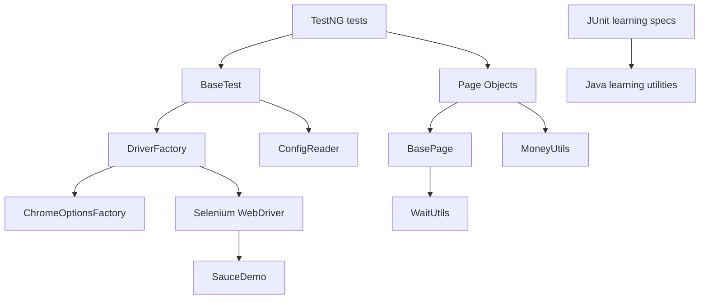
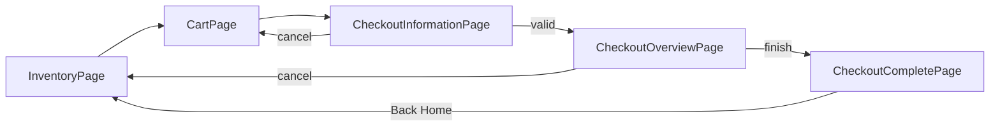

# Phase 6 — Page Object Model + Hybrid Selenium Framework

Ye guide actual `C:\devlabs` implementation explain karti hai. “Illustrative” label wale snippets concept samjhane ke liye hain; baaki class/method names project ke real code se hain.

## Chapter 1 — Page Object Model kya hai?

Page Object Model (POM) mein har application page ko Java class represent karti hai. Locator aur UI action Page Object mein, business expectation aur `Assert` test mein rehta hai. Pehle five test classes username/password/login locators, waits aur product/cart XPath repeat karti thi. UI selector change hota to multiple files change karne padte.

Before:

```java
driver.findElement(By.id("user-name")).sendKeys(user);
driver.findElement(By.id("login-button")).click();
```

After:

```java
InventoryPage inventory = loginPage().loginAs(user, password);
Assert.assertTrue(inventory.isInventoryDisplayed());
```

POM duplication kam karta hai, lekin test logic hide nahi karta. Page tells “UI kaise use hogi”; test tells “business result kya hona chahiye”.

## Chapter 2 — Actual POM architecture



- Test layer: 49 original TestNG scenarios + seven DataProvider invocations.
- Page layer: Login, Inventory, Product Details, Cart and three Checkout pages.
- Core: configuration and driver creation.
- Utility: explicit waits and deterministic money operations.
- Model: immutable `CheckoutInformation` record.
- Learning: TestNG/JUnit examples remain isolated.

Selenium dependency test-scoped hai, isliye framework packages `src/test/java` mein rakhe gaye. Is project mein production application code nahi hai; dependency scope badalne ki zarurat nahi padi.

## Chapter 3 — POM mein Java OOP

- **Class/Object:** `LoginPage` blueprint hai; `new LoginPage(driver)` current session ka object.
- **Constructor injection:** WebDriver constructor se diya jata hai; hidden global state nahi.
- **Encapsulation:** locators `private static final`; tests unhe directly touch nahi karte.
- **Inheritance:** every page extends `BasePage`; every Selenium test extends `BaseTest`.
- **Abstraction:** test `addProductToCart(name)` call karta hai, click/wait details nahi.
- **Polymorphism:** inherited `currentUrl()` har page object par available hai. Heavy runtime polymorphism deliberately add nahi kiya.
- **`final`:** page objects, utilities, locators and immutable references accidental extension/mutation rokate hain.
- **`static`:** config access and stateless utilities; WebDriver static nahi hai.
- **Access:** public business API, protected shared page primitives, private locators/helpers.

## Chapter 4 — BasePage line by line

`BasePage` stores `protected final WebDriver driver` and `WaitUtils waits`. Constructor injected driver ko save karta aur configured timeout se waits banata hai. `visible`, `clickable`, `click`, `enterText`, `text`, `elements`, and `isPresent` small reusable primitives hain. `currentUrl()` and `pageTitle()` observable browser state expose karte hain.

```java
protected BasePage(WebDriver driver) {
    this.driver = driver;
    this.waits = new WaitUtils(driver, ConfigReader.explicitWait());
}
```

`protected` ka matlab child pages use kar sakti hain, tests nahi. BasePage giant utility nahi: sorting, logout, checkout, products jaise page-specific actions respective page classes mein hain. Koi assertion BasePage/Page Object mein nahi hai.

## Chapter 5 — BaseTest

`BaseTest` TestNG lifecycle centralize karta hai:

```java
@BeforeMethod(alwaysRun = true)
public void setUpBrowser() {
    driver = DriverFactory.createDriver();
    driver.get(ConfigReader.baseUrl());
}

@AfterMethod(alwaysRun = true)
public void tearDownBrowser() {
    if (driver != null) {
        driver.quit();
        driver = null;
    }
}
```

Superclass `@BeforeMethod` pehle browser banata hai; Product/Cart/Checkout subclass configuration usi driver par login karti hai. Second browser create nahi hota. Every test/DataProvider row fresh cookies/cart/session leti hai. `alwaysRun=true` group-filtered suite aur failure cleanup ke liye critical hai.

## Chapter 6 — DriverFactory

Factory browser-construction decision ek jagah rakhta hai. `DriverFactory.createDriver()` configured browser validate karke:

```java
return new ChromeDriver(ChromeOptionsFactory.passwordPromptsDisabled());
```

call karta hai. Selenium Manager compatible driver resolve karta hai; local executable path hardcode nahi. Mutable static driver nahi. Existing factory ke preferences preserve hain:

```java
"credentials_enable_service", false
"profile.password_manager_leak_detection", false
```

Ye sirf Selenium-created temporary profile affect karti hain, personal Chrome profile/account nahi.

## Chapter 7 — LoginPage

Stable `id` locators username, password and login button ke liye use hote hain; error ke liye `data-test`. `waitUntilReady()` form visibility/clickability prove karta hai. `loginAs()` success path par `InventoryPage` return karta; `submitInvalidLogin()` accurately `LoginPage` return karta. Negative action ko success page type dena fragile hota.

Field APIs enabled state, value, password type aur clearing expose karti hain. Logout InventoryPage mein hai because menu inventory shell ka behavior hai; logout result ready `LoginPage` hai.

## Chapter 8 — InventoryPage

InventoryPage readiness URL + visible inventory container se establish hoti hai. It exposes:

- names and ordered prices as lists;
- name-to-price mapping;
- name/description/image source and element counts;
- sort selection with selected-option wait;
- product-name-scoped add/remove state;
- exact cart badge wait;
- cart/detail navigation;
- animated sidebar logout.

Product container XPath product name se scoped hai, list index se nahi. `List` display order preserve karti hai; `LinkedHashMap` product identity and order preserve karta hai.

## Chapter 9 — ProductDetailsPage

Details page URL fragment and details container wait karti hai. Name, description and BigDecimal price expose hote hain. Add/remove supported actions ke baad opposite button state wait hota hai. `backToProducts()` loaded `InventoryPage` return karta hai. ProductTest inventory snapshot ko details values se exact compare karta hai.

## Chapter 10 — CartPage

CartPage URL + cart-list readiness use karta hai. Product names, price by name, complete price map, remove, badge wait, continue-shopping and checkout actions available hain. Page assertion nahi karti; `CartTest` exact selected set, duplicate count, remaining item and name-to-price consistency assert karta hai.

## Chapter 11 — Checkout pages



- `CheckoutInformationPage`: controls, enabled state, form fill, exact error, cancel and valid continue.
- `CheckoutOverviewPage`: products, prices, quantities, calculated subtotal, displayed subtotal/tax/total, finish/cancel.
- `CheckoutCompletePage`: complete heading/message and Back Home.
- `CheckoutInformation` record immutable test data hai; null values empty strings mein normalize hote hain.

Tax percentage hardcode nahi. Test displayed subtotal + displayed tax = displayed total assert karta hai.

## Chapter 12 — Configuration management

`src/test/resources/config.properties` classpath se load hota hai:

```properties
base.url=https://www.saucedemo.com/
browser=chrome
explicit.wait.seconds=10
```

`ConfigReader` missing/blank keys fail-fast karta hai, wait seconds numeric/positive validate karta hai, aur `-Dbase.url=...` style safe system override allow karta hai. Machine path nahi. Real secret nahi. Public demo credentials existing test-data constants mein hi hain.

## Chapter 13 — WaitUtils

Explicit waits visibility, all-visible elements, clickability, URL equality/fragment, invisibility and focused custom condition support karte hain. Page readiness URL + unique container se verify hoti hai. `TimeoutException` swallow nahi hota, so failing locator/response stack trace visible rahta hai. Implicit wait aur `Thread.sleep()` nahi; sleep fast response par bhi fixed delay aur slow response par flakiness create karta.

## Chapter 14 — MoneyUtils

Currency text se nonnumeric label/currency characters remove karke `BigDecimal` parse hota hai. Null, blank numeric content and malformed number descriptive exceptions dete hain. `add(Collection<BigDecimal>)` and `multiply(amount, quantity)` deterministic hain; negative quantity reject hoti hai.

```java
BigDecimal item = MoneyUtils.multiply(new BigDecimal("9.99"), 2); // 19.98
int same = actual.compareTo(expected); // numeric equality when 0
```

`double` binary rounding risk deta hai. No extra tax/rounding assumption introduced.

## Chapter 15 — Practical hybrid framework

“Hybrid” here means POM + DataProvider + TestNG groups/XML + JUnit unit learning + external config + shared lifecycle/waits/money utility + Maven. Implemented nahi: Excel keyword engine, database, API layer, reporting product, retry framework, ThreadLocal/parallel grid, CI/CD. Ye deliberate scope control hai.

## Chapter 16 — Test refactoring examples

Login before: test locators se `sendKeys/click/wait`. After: `loginPage().loginAs(...)`; inventory visibility and URL assertions same business meaning ke saath test mein.

Cart before: test product XPath banata, price parse karta, cart click karta. After: InventoryPage add/price and CartPage name/price APIs; test still exact set, count and each product price compares.

Checkout before: one class had form/product/summary/complete locators. After: navigation page return types se visible hai. Test still exact required errors, identities, prices, quantity subtotal, tax-total and confirmation validates. Assertions weaker visibility-only checks se replace nahi hue.

## Chapter 17 — SOLID relation

- **SRP:** DriverFactory creates browsers; ConfigReader reads config; pages model UI; tests assert.
- **OCP:** new Page Object/test add ho sakta without existing page internals changing. Full plugin-style extensibility claim nahi.
- **LSP:** page subclasses BasePage primitives safely inherit; BasePage references substitute karne ka business need limited hai.
- **ISP:** interfaces add nahi kiye because one implementation ke liye empty abstraction overengineering hoti.
- **DIP:** pages constructor-injected WebDriver depend karti hain, but concrete Selenium API dependency remains appropriate. Full dependency inversion/container claim nahi.

## Chapter 18 — Common architecture mistakes

1. Page Object mein Assert: responsibility mix.
2. Giant BasePage: unrelated domain behavior hidden.
3. Static shared WebDriver: state leakage/thread risk.
4. Duplicate locators: maintenance multiplier.
5. Deep inheritance: lifecycle/debugging unclear.
6. Multi-browser factory without requirement: fake complexity.
7. Real credentials config mein: secret leak.
8. Blind sleeps/retries: defects hide/flakiness.
9. Unit tests ko browser/network dena: slow nondeterministic tests.
10. Wrong return type: invalid login method returning InventoryPage.
11. Cached WebElement lists across navigation: stale element failures.
12. Page method doing complete assertion flow: test intent invisible.

## Chapter 19 — Debugging scenarios (12)

| Symptom | Possible root cause | Investigation | Corrective action |
|---|---|---|---|
| Null driver | BaseTest not inherited/config skipped | lifecycle report/stack | extend BaseTest; `alwaysRun=true` |
| Two Chrome windows | old + inherited setup | search `new ChromeDriver` | keep DriverFactory-only creation |
| Browser remains | teardown skipped/quit failed | process + config report | null-safe `@AfterMethod(alwaysRun=true)` |
| TimeoutException | wrong locator/page/app delay | URL, DOM, screenshot | fix demonstrated cause; page readiness |
| StaleElementReference | cached element after DOM update | locate stack line | re-find through locator/page method |
| Wrong returned page | navigation method contract false | URL/container inspect | return type matching actual navigation |
| Config missing | resource not copied/key absent | inspect `target/test-classes` | restore properties/classpath key |
| Wrong locator | DOM changed/selector broad | DevTools + `findElements` | stable `id`/`data-test`, scoped selector |
| Password popup | plain ChromeDriver path | search constructor/options | use DriverFactory → ChromeOptionsFactory |
| Group null driver | setup filtered | run XML and inspect configs | setup/teardown `alwaysRun=true` |
| Surefire wrong count | name matches discovery | inspect five XML reports | explicit learning names/commands |
| DataProvider failure | type/count/session leak | dataset + signature + lifecycle | align row args; fresh BaseTest session |

## Chapter 20 — Interview questions and answers (40)

1. **POM kya hai?** Pages ko classes mein encapsulate karke tests ko business-focused banane ka pattern.
2. **POM framework hai?** Nahi, design pattern; framework uske around lifecycle/data/config add karta hai.
3. **Locator kaha?** Relevant Page Object mein private static final.
4. **Assertion kaha?** Test class mein, so expected business behavior clear rahe.
5. **BasePage purpose?** Small reusable Selenium primitives and shared driver/wait.
6. **Giant BasePage kyun bad?** Domain responsibilities mix aur hidden coupling.
7. **BaseTest purpose?** Fresh browser setup/navigation and guaranteed cleanup.
8. **Constructor injection?** Required driver explicitly page ko dena.
9. **Static WebDriver kyun nahi?** Shared mutable session causes contamination and blocks safe parallel evolution.
10. **Factory pattern use?** Browser construction decision centralized.
11. **Selenium Manager?** Matching driver automatically resolves; executable path hardcode unnecessary.
12. **ChromeOptions fix?** Automation profile mein credential service/leak warning disable.
13. **Personal profile affect?** Nahi; Selenium temporary profile only.
14. **Page readiness?** Expected URL plus unique visible container/state.
15. **Explicit vs implicit wait?** Specific condition vs global lookup delay; project explicit only.
16. **Thread.sleep problem?** Fixed delay, slow failure risk, unnecessary runtime.
17. **Fluent return type benefit?** Clear navigation and optional readable chaining.
18. **Invalid login return type?** LoginPage, because navigation rejected.
19. **Product locator stable kaise?** `data-test` and name-scoped container, not index.
20. **List vs Set?** List order/duplicates; Set identity membership.
21. **LinkedHashMap why?** Name→price identity with stable encounter order.
22. **BigDecimal why?** Exact decimal money arithmetic.
23. **compareTo vs equals?** compareTo numeric value; equals value plus scale.
24. **Tax hardcode kyun nahi?** App display is source; product does not expose tax-rule contract.
25. **ConfigReader benefit?** environment values external and validated.
26. **System override?** `-Dkey=value` without editing resource.
27. **Secrets config mein?** No; source control leak risk.
28. **Record benefit?** Concise immutable checkout data carrier.
29. **DataProvider + POM?** data varies; same page workflow reusable; each row fresh session.
30. **Hybrid framework meaning?** Multiple justified testing capabilities combined, not every possible pattern.
31. **Test isolation?** Every method/invocation new driver and no dependent state.
32. **alwaysRun?** Selected groups/failure path mein essential config executes.
33. **Group suite setup issue?** configuration filter ho sakti; alwaysRun fixes mandatory lifecycle.
34. **Stale element prevent?** WebElements long-term cache nahi; locator se state re-read.
35. **Navigation method debug?** returned page `waitUntilLoaded` fails near transition.
36. **Maven test scope why?** Framework test automation hai; production classpath pollution avoid.
37. **Surefire role?** discovery/provider/execution/XML report during Maven test.
38. **JUnit role here?** Fast isolated Java utilities learning tests; no browser.
39. **Parallel readiness?** Static driver absent, but ThreadLocal/parallel not implemented until required.
40. **New page kaise add?** BasePage extend, private locators, meaningful actions/state, then independent test.

## Chapter 21 — Coding practice with solutions (15)

1. **BasePage:** constructor mein `WebDriver`/`WaitUtils`; protected `click(By)`.
2. **LoginPage:** private IDs; `loginAs` returns loaded InventoryPage.
3. **Constructor injection:** `new CartPage(driver)`; static driver avoid.
4. **Reusable click:** `waits.clickable(locator).click()`.
5. **Reusable visibility wait:** `return wait.until(visibilityOfElementLocated(locator));`.
6. **DriverFactory:** private constructor + `createDriver()` using ChromeOptionsFactory.
7. **Preferences:** Map mein credential service and leak detection false preserve.
8. **ConfigReader:** classloader stream, missing key validation, system override.
9. **Product list:** elements map to trimmed name list.
10. **Price map:** loop names and `LinkedHashMap.put(name, BigDecimal)`.
11. **CartPage:** URL/container ready; remove waits product absence.
12. **Checkout model:** `record CheckoutInformation(first,last,postal)`.
13. **Subtotal:** each `price × integer quantity`, then BigDecimal add.
14. **POM refactor:** raw locator lines move page; assertion stays test.
15. **Navigation test:** action return page, assert exact URL + unique visible state.

Practice solution rule: methods purposeful rakho, errors swallow mat karo, WebElement cache mat karo, test assertion page mein move mat karo.

## Chapter 22 — Full framework walkthrough

```text
src/test/java/com/shopflow/
├── core/        ConfigReader, DriverFactory
├── models/      CheckoutInformation
├── pages/       BasePage + seven concrete pages
├── utils/       WaitUtils, MoneyUtils
├── tests/       BaseTest + 49 tests + DataProvider + Chrome options
└── learning/    isolated TestNG and JUnit examples
src/test/resources/config.properties
```

Flow: Surefire/TestNG creates test → BaseTest asks DriverFactory → factory reuses protected Chrome options → driver opens configured URL → test creates LoginPage → page actions call BasePage/WaitUtils → WebDriver operates SauceDemo → new page object waits readiness → test reads page state and asserts → BaseTest quits driver.

Class purposes: ConfigReader validated values; DriverFactory only driver path; BaseTest lifecycle; BasePage primitives; LoginPage authentication/form; InventoryPage listing/sorting/cart/menu; ProductDetailsPage details; CartPage cart; three checkout pages stage-specific behavior; CheckoutInformation immutable data; WaitUtils synchronization; MoneyUtils currency arithmetic.

## Chapter 23 — Final revision

POM cheat sheet: private locators, constructor driver, meaningful actions/state, accurate navigation return, assertions in tests. Hybrid cheat sheet: POM + data + TestNG/JUnit + config + utilities + Maven. OOP cheat sheet: encapsulation, shallow inheritance, constructor injection, immutable record, stateless utilities.

Verified commands:

```powershell
$maven = Join-Path $env:TEMP 'shopflow-maven-3.10.0\apache-maven-3.10.0\bin\mvn.cmd'
& $maven clean test
& $maven verify
& $maven -DskipTests test-compile '-Dtestng.suite=testng-regression.xml' exec:java
& $maven -DskipTests test-compile '-Dtestng.suite=testng-smoke.xml' exec:java
& $maven '-Dtest=PriceCalculatorJupiterSpec,InputValidatorJupiterSpec' test
```

Interview traps: POM ko test framework bolna; assertions page mein; shared driver; invalid return type; sleep/retry; `double` money; test counts across runs add karna. Final assignment: new supported SauceDemo page inspect karo, BasePage extend karo, stable locators/actions add karo, exact independent assertions likho, targeted then full regression run karo.

Phase 6 checklist: backup ✅; baseline ✅; DriverFactory/BaseTest/BasePage ✅; seven pages ✅; config/waits/money/model ✅; 49 names and assertions preserved ✅; DataProvider/TestNG/JUnit ✅; no sleep/JS/retry/parallel ✅; cleanup ✅; docs ✅; no commit/push ✅.
