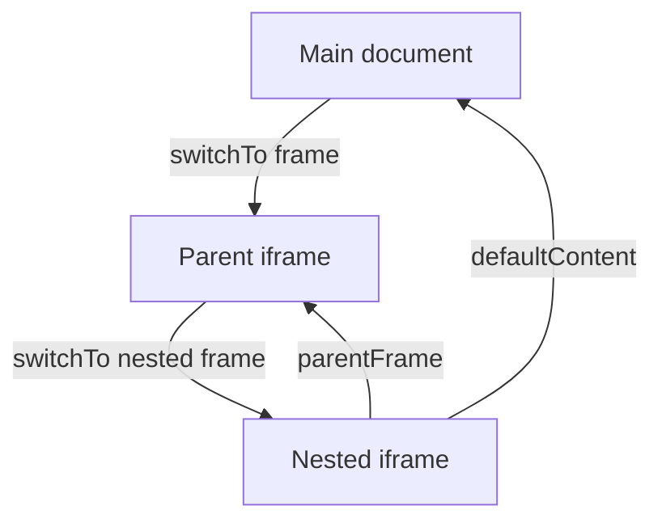

# Phase 7 — Advanced Selenium WebDriver Automation

Yeh guide Phase 7 ke 33 locally hosted browser-interaction tests ko beginner se interview-ready level tak explain karti hai. SauceDemo ke original business flows change nahi hue. Alerts, frames, tabs, drag/drop jaise features SauceDemo mein nahi hain, isliye deterministic `file:` fixtures use kiye gaye.

## Chapter 1 — Advanced Selenium Introduction

Advanced Selenium ka matlab sirf `click()` aur `sendKeys()` nahi, balki browser ke alag contexts aur input devices ko safely control karna hai. Alert, iframe, window, shadow root aur active element har ek different context/state hai. Driver jis context mein hai, locator wahi search karta hai. Isliye test ka core pattern hai: correct context select karo, condition ka explicit wait karo, action karo, observable result assert karo, context/session clean karo.

Architecture flow:

```text
TestNG case -> advanced Page Object -> BasePage/WaitUtils -> WebDriver -> local HTML fixture
```

## Chapter 2 — JavaScript Alerts

Alert modal DOM element nahi hota. `ExpectedConditions.alertIsPresent()` ke baad `driver.switchTo().alert()` use hota hai. `getText()` message deta hai, `accept()` OK, `dismiss()` Cancel aur prompt mein `sendKeys()` input deta hai. Implemented tests TC_ADV_001–005 simple alert accept, confirm accept/dismiss, prompt input aur prompt dismiss cover karte hain.

```java
Alert alert = waits.until(ExpectedConditions.alertIsPresent());
Assert.assertEquals(alert.getText(), "Operation completed");
alert.accept();
```

Line-by-line idea: fixture button event modal kholta hai; wait race condition remove karta hai; switch context driver ko modal par le jata hai; message business evidence hai; accept/dismiss final choice hai; DOM status assertion browser response verify karti hai.

## Chapter 3 — Frames and iFrames

`iframe` apna document rakhta hai. Main DOM se iframe ke andar element directly locate nahi hoga. `switchTo().frame(WebElement)` ya `frameToBeAvailableAndSwitchToIt` use karo. Nested frame ke liye har level traverse hota hai; `parentFrame()` ek level up aur `defaultContent()` seedha top document par lata hai.



TC_ADV_006–009 element-based switch, inner interaction, nested navigation aur default-content restoration verify karte hain.

## Chapter 4 — Multiple Windows and Tabs

Har browsing context ka unique handle hota hai. `getWindowHandle()` current string aur `getWindowHandles()` `Set<String>` deta hai. New handle ko reliable tarike se find karne ke liye before/after set difference use hua—handle order assume nahi kiya.

```java
Set<String> before = driver.getWindowHandles();
// open child and wait for expected count
Set<String> added = new HashSet<>(driver.getWindowHandles());
added.removeAll(before);
driver.switchTo().window(added.iterator().next());
```

TC_ADV_010–013 tab/window content, title, child close, parent return aur multiple-handle cleanup cover karte hain. Closed handle par switch nahi karna; child close ke baad parent handle explicitly restore karo.

## Chapter 5 — Actions API

`Actions` W3C input sequence build karta hai. `moveToElement`, `doubleClick`, `contextClick`, `dragAndDrop`, `clickAndHold` aur `release` complex user gestures model karte hain. `.perform()` ke bina sequence execute nahi hota. TC_ADV_014–018 hover tooltip, double click, right click, HTML drag/drop aur hold/release ke visible status assert karte hain. JavaScript click workaround use nahi hua.

## Chapter 6 — Keyboard Automation

`Keys` non-character keys model karta hai. `Keys.chord(Keys.CONTROL, "a")` select-all hai; `TAB` focus move karta hai; `ENTER` form submit karta hai. Modifier ko `keyDown` ke baad `keyUp` zaroor karo, warna following input affected ho sakta hai. TC_ADV_019–022 value replacement, `activeElement`, enter-submit aur Shift uppercase verify karte hain.

## Chapter 7 — Dropdown Automation

Real `<select>` ke liye Selenium `Select` wrapper correct abstraction hai: `selectByVisibleText`, `selectByValue`, `getFirstSelectedOption`, `getAllSelectedOptions`. Custom dropdown `<select>` nahi hota, isliye trigger aur option normal locators/click se automate hote hain. TC_ADV_023 native selection, TC_ADV_024 multi-select order, aur TC_ADV_025 custom choice plus collapsed ARIA state assert karte hain.

## Chapter 8 — Dynamic Elements

Dynamic DOM asynchronous timers/network/rendering se change hota hai. Element visible late ho sakta hai, loader disappear ho sakta hai, node replace hokar purana `WebElement` stale ho sakta hai, ya disabled control enabled ho sakta hai. TC_ADV_026–029 exactly ye four states cover karte hain. Element replacement mein old reference ki `stalenessOf` aur new `data-version` dono verify hote hain.

## Chapter 9 — Explicit and Fluent Waits

`WebDriverWait` known conditions ke liye readable hai. `ExpectedConditions` visibility, clickability, invisibility, staleness, frame aur window count cover karta hai. `FluentWait` timeout, polling interval aur ignored transient exception customize karta hai. Polling har 100 ms condition check karti hai, blind retry nahi. `Thread.sleep()` fixed delay hai: fast environment mein time waste aur slow environment mein flaky; is phase mein use nahi hua. Implicit wait bhi add nahi kiya, so wait types mix nahi hue.

## Chapter 10 — File Upload Automation

Browser file picker OS UI hai aur WebDriver usko directly control nahi karta. `<input type="file">` ko absolute path `sendKeys()` karna supported route hai. TC_ADV_030 `Files.createTempFile`, content write, upload, exact filename assertion aur `finally` cleanup use karta hai. Real user file ya permanent artifact leave nahi hota.

## Chapter 11 — Shadow DOM

Shadow host normal DOM element hai; uska shadow root separate search context hai. Selenium 4 mein `host.getShadowRoot()` `SearchContext` deta hai, then root ke andar locate kiya jata hai. TC_ADV_031 open shadow root ke button/status ko verify karta hai. Closed shadow root WebDriver se directly accessible nahi hota—component ka public test contract ya application support chahiye.

## Chapter 12 — Scrolling

Page scrolling viewport move karta hai; scroll container apna internal scroll offset move karta hai. `Actions.scrollToElement` page target aur `scrollFromOrigin(ScrollOrigin.fromElement(...))` overflow container ke liye W3C wheel input use karta hai. TC_ADV_032–033 scroll ke baad real click aur status assertion karte hain; JavaScript scroll/click nahi.

## Chapter 13 — Local Fixture Architecture

Fixtures `src/test/resources/advanced-fixtures` mein HTML, shared CSS aur JavaScript ke saath hain. `FixtureResources.uri()` classpath resource ko URI banata hai; packaged paths manually hardcode nahi hote. Local pages fast, repeatable, offline-friendly aur third-party changes/rate limits se independent hain. Timers intentionally 250–300 ms hain so waits genuinely exercise hote hain but suite slow nahi hoti. Ye fixtures SauceDemo feature hone ka claim nahi karte.

## Chapter 14 — Phase 7 Page Objects

- `AlertsPage`: modal open/switch/accept/dismiss/prompt and result state.
- `FramesPage`: main, parent, nested context navigation and actions.
- `WindowsPage`: handle counts, set difference, switching and closing.
- `ActionsPage`: reusable mouse gesture methods and result readers.
- `KeyboardPage`: chords, focus, submit and modifiers.
- `DropdownsPage`: native `Select`, multi-select and custom menu.
- `DynamicPage`: visibility, loader, staleness, FluentWait and enablement.
- `FileUploadPage`: absolute-path upload and filename feedback.
- `ShadowDomPage`: host-to-shadow-root traversal via `SearchContext`.
- `ScrollingPage`: W3C viewport and container wheel actions.

Sab `BasePage` extend karte hain, private stable `By.id`/CSS locators rakhte hain, constructor injection se driver lete hain aur assertions test layer mein chhodte hain. `AdvancedFixtureTest` only fixture opening concern add karta hai. `BaseTest.initialUrl()` hook ne existing SauceDemo default preserve kiya.

## Chapter 15 — TestNG Integration

Har case `advanced` group mein hai aur fresh driver `@BeforeMethod`/`@AfterMethod(alwaysRun=true)` lifecycle se milta hai. Classes ka suffix `AdvancedCases` hai, isliye default Surefire `*Test` discovery original 49 par unchanged rehti hai. `testng-advanced.xml` explicit ten classes select karta hai. Run command:

```powershell
$maven = Join-Path $env:TEMP 'shopflow-maven-3.10.0\apache-maven-3.10.0\bin\mvn.cmd'
& $maven -DskipTests test-compile '-Dtestng.suite=testng-advanced.xml' exec:java
```

## Chapter 16 — Java Collections in Selenium

`Set<String>` window handles ke liye natural hai because handles unique aur unordered hain. `HashSet.removeAll` new contexts isolate karta hai. `List<WebElement>` ordered option collections deta hai; stream mapping selected WebElements ko values ki `List<String>` mein convert karti hai. `Map` is phase code mein force nahi kiya—jab key/value test data ho tab useful hai, e.g. expected field states.

## Chapter 17 — Advanced Selenium Exceptions

| Exception | Symptom | Diagnosis | Fix |
|---|---|---|---|
| `NoAlertPresentException` | alert switch fails | alert not open/late | `alertIsPresent()` wait |
| `NoSuchFrameException` | frame switch fails | wrong context/locator | top context check + frame wait |
| `NoSuchWindowException` | handle unavailable | child closed/wrong handle | live handle set and parent restore |
| `StaleElementReferenceException` | cached element detached | DOM node replaced | wait staleness, re-locate new node |
| `ElementClickInterceptedException` | overlay blocks click | visibility != clickability | wait actual overlay/state; inspect DOM |
| `TimeoutException` | condition never met | bad locator/state/timeout | screenshot, URL, DOM and condition review |

Exception ko catch karke ignore karna solution nahi. Root state diagnose karo aur page-specific wait condition lagao.

## Chapter 18 — Real-World QA Scenarios

Hypothetical mappings: payment confirmation alert, analytics dashboard iframe, OAuth tab, kanban drag/drop, country dropdown, delayed search results, document upload, web-component shadow root aur infinite-scroll catalog. Phase 7 ne real payment, OAuth, production upload ya infinite scrolling execute nahi ki; only isolated fixtures par underlying Selenium mechanics validate hue.

## Chapter 19 — Complete Test Cases

Har row ka flow: fresh browser -> fixture -> page action -> observable assertion -> guaranteed quit.

| ID | Method | Scenario and expected result |
|---|---|---|
| 001 | `simpleAlertShouldExposeTextAndAccept` | exact alert text, accept, success status |
| 002 | `acceptedConfirmationShouldUpdateStatus` | confirm OK -> Confirmed |
| 003 | `dismissedConfirmationShouldUpdateStatus` | confirm Cancel -> Cancelled |
| 004 | `promptShouldDisplayEnteredValue` | prompt input -> greeting |
| 005 | `dismissedPromptShouldDisplayCancelledState` | prompt cancel -> cancelled state |
| 006 | `switchIntoFrameByElement` | parent iframe heading visible |
| 007 | `interactInsideFrame` | parent action -> Parent clicked |
| 008 | `navigateNestedFrames` | nested action then parent restoration |
| 009 | `returnToDefaultContent` | top action works after defaultContent |
| 010 | `openAndSwitchToTab` | new tab kind and heading |
| 011 | `openSeparateWindow` | child window kind and title |
| 012 | `closeChildAndReturnToParent` | one parent handle remains |
| 013 | `manageMultipleChildHandles` | three handles, inspect/close both children |
| 014 | `hoverRevealsTooltip` | tooltip displayed after hover |
| 015 | `doubleClickTriggersAction` | exactly one double-click event |
| 016 | `contextClickTriggersAction` | custom context event status |
| 017 | `dragAndDropCompletes` | native drop event success |
| 018 | `clickHoldAndRelease` | mouse released state |
| 019 | `controlAReplacesText` | input becomes Updated |
| 020 | `tabMovesFocus` | active element becomes second field |
| 021 | `enterSubmitsForm` | submitted value appears |
| 022 | `shiftModifierCreatesUppercase` | value/status both ABC |
| 023 | `selectNativeOption` | Beta maps to value beta |
| 024 | `selectMultipleOptions` | red and blue selected |
| 025 | `selectCustomOption` | two selected and popup collapsed |
| 026 | `waitForDelayedVisibility` | Now visible after timer |
| 027 | `waitForLoadingSequence` | loader gone, content loaded |
| 028 | `waitForElementReplacement` | old stale, new version 2 |
| 029 | `waitUntilButtonEnabled` | disabled button becomes enabled |
| 030 | `uploadTemporaryFile` | selected filename matches temp file |
| 031 | `interactInsideOpenShadowRoot` | shadow status becomes clicked |
| 032 | `scrollPageToElement` | page-bottom button clicked |
| 033 | `scrollOverflowContainer` | container-bottom button clicked |

Tests Page Object method call se implementation hide karte hain, exact assertions behavior prove karti hain, aur independent fixtures ordering dependency prevent karte hain.

## Chapter 20 — Interview Questions

1. **Advanced Selenium kya cover karta hai?** Multiple browser contexts, input devices, async states aur modern DOM boundaries.
2. **Alert DOM locator se kyon nahi milta?** Woh browser modal context hai, document node nahi.
3. **Alert ka reliable wait?** `ExpectedConditions.alertIsPresent()`.
4. **Confirm accept aur dismiss difference?** Accept OK path; dismiss Cancel path execute karta hai.
5. **Prompt mein text kaise dete hain?** Switched `Alert` par `sendKeys`, then accept.
6. **iframe kya hai?** Parent page ke andar independent embedded document.
7. **Frame switch approaches?** Index, name/id, ya WebElement; stable WebElement/locator preferred.
8. **`parentFrame()` vs `defaultContent()`?** One level up vs top document.
9. **Frame wait kyon?** Frame element present ho sakta hai but content context ready na ho.
10. **Window handle kya hai?** Browsing context ka unique opaque string.
11. **New tab reliable kaise identify karein?** Before/after handle set difference.
12. **Handle order assume kar sakte hain?** Nahi, `Set` unordered hai.
13. **Child close ke baad kya karna hai?** Known live parent handle par switch.
14. **`Actions` ka purpose?** Composite W3C mouse/keyboard/wheel sequences.
15. **`build()` aur `perform()`?** Build sequence banata; perform execute karta. Direct chained `.perform()` both karta hai.
16. **Hover ka method?** `moveToElement(element).perform()`.
17. **Right-click ka method?** `contextClick(element).perform()`.
18. **Drag/drop failure ka first investigation?** Event model, visibility, coordinates aur native HTML handlers inspect karo—not JS fallback.
19. **Click-and-hold cleanup?** Same action sequence mein `release()`.
20. **Ctrl+A portable concern?** Windows/Linux Control; macOS Command may need platform-aware modifier.
21. **Active focus kaise assert karein?** `driver.switchTo().activeElement()`.
22. **Modifier key leak kaise avoid karein?** `keyUp()` pair ya chord use karo.
23. **Selenium `Select` kab valid hai?** Only actual HTML `<select>`.
24. **Custom dropdown automate kaise?** Trigger click, option locate/click, displayed/ARIA state assert.
25. **Multi-select check?** `isMultiple()` and `getAllSelectedOptions()`.
26. **Dynamic element kya hai?** Async render/update/replacement wala element.
27. **Stale element meaning?** Stored WebElement ab current DOM node se attached nahi.
28. **Stale element fix?** Expected replacement wait karke re-locate; blind retry nahi.
29. **Explicit wait kya hai?** Bounded wait for a stated condition.
30. **FluentWait advantage?** Custom timeout, polling aur selected ignored exceptions.
31. **Implicit + explicit mix problem?** Nested wait timing unpredictable ho sakta hai.
32. **`Thread.sleep` flaky kyon?** Condition nahi dekhta, fixed time assumes karta hai.
33. **Loader ke liye best condition?** Visible/started evidence then invisibility, followed by final content.
34. **File upload ka supported technique?** File input ko absolute path `sendKeys`.
35. **OS dialog automate kyon nahi?** WebDriver browser DOM protocol control karta hai, native desktop UI nahi.
36. **Temp file cleanup kahan?** `finally` block mein.
37. **Shadow host vs root?** Host light DOM node; root encapsulated search boundary.
38. **Open shadow root access?** `getShadowRoot()` returning `SearchContext`.
39. **Closed shadow root?** Selenium direct traversal unavailable.
40. **W3C wheel actions benefit?** Real input semantics, JS execution dependency nahi.
41. **Viewport vs container scroll?** Page document offset vs element ka internal scroll offset.
42. **Local fixture benefit?** Determinism, speed, offline repeatability and owned states.
43. **Fixture limitation?** Production integration/real browser app behavior ka substitute nahi.
44. **Page Object mein assertions?** Generally tests mein, so behavior orchestration and verification separate rahe.
45. **Advanced suite legacy se isolated kaise hai?** `AdvancedCases` naming + explicit XML/group; default `*Test` discovery unchanged.

## Chapter 21 — Coding Exercises

Har solution intentionally short hai; actual project versions mein Page Object encapsulation use hui hai.

1. **Alert accept:** `wait.until(alertIsPresent()).accept();`
2. **Alert text:** `String message = wait.until(alertIsPresent()).getText();`
3. **Prompt value:** `Alert a=wait.until(alertIsPresent()); a.sendKeys("Uday"); a.accept();`
4. **Frame by element:** `driver.switchTo().frame(wait.until(visibilityOfElementLocated(By.id("frame"))));`
5. **Nested frame:** `driver.switchTo().frame("outer"); driver.switchTo().frame("inner");`
6. **Return top:** `driver.switchTo().defaultContent();`
7. **New window difference:** `Set<String> added=new HashSet<>(driver.getWindowHandles()); added.removeAll(before);`
8. **Close children:** `for(String h:handles) if(!h.equals(parent)){driver.switchTo().window(h);driver.close();}`
9. **Hover:** `new Actions(driver).moveToElement(element).perform();`
10. **Double-click:** `new Actions(driver).doubleClick(element).perform();`
11. **Right-click:** `new Actions(driver).contextClick(element).perform();`
12. **Drag/drop:** `new Actions(driver).dragAndDrop(source,target).perform();`
13. **Ctrl+A replace:** `input.sendKeys(Keys.chord(Keys.CONTROL,"a"),"new");`
14. **Tab focus:** `input.sendKeys(Keys.TAB); String id=driver.switchTo().activeElement().getAttribute("id");`
15. **Native select:** `new Select(select).selectByVisibleText("Beta");`
16. **Multi-select values:** `new Select(select).getAllSelectedOptions().stream().map(e->e.getAttribute("value")).toList();`
17. **Wait stale:** `wait.until(ExpectedConditions.stalenessOf(oldElement));`
18. **Upload:** `fileInput.sendKeys(path.toAbsolutePath().toString());`
19. **Shadow root:** `SearchContext root=host.getShadowRoot(); root.findElement(By.id("button")).click();`
20. **Scroll to element:** `new Actions(driver).scrollToElement(element).perform();`

Practice extension: har snippet ko private locator + meaningful Page Object method + independent TestNG assertion mein convert karo.

## Chapter 22 — Debugging Practice

| # | Error | Likely cause | Investigation | Fix and prevention |
|---|---|---|---|---|
| 1 | `NoAlertPresentException` | modal late/not opened | screenshot, click result, alert wait | wait `alertIsPresent`; stable trigger |
| 2 | `UnexpectedAlertPresentException` | modal unhandled | capture alert text | explicitly accept/dismiss before DOM work |
| 3 | `NoSuchFrameException` | wrong context/locator | list frames, inspect current page | defaultContent then frame availability wait |
| 4 | element not found after frame switch | switched wrong nesting | inspect frame tree | traverse each level; use parent/default correctly |
| 5 | `NoSuchWindowException` | closed/stale handle | log current/live handles | retain parent; switch only to live handles |
| 6 | child content assertion hits parent | new context not selected | title/URL/handle log | before/after set difference then switch |
| 7 | hover tooltip timeout | element offscreen/overlay | screenshot and computed visibility | clickable/visible target; W3C move action |
| 8 | drag/drop no status | fixture event model differs | browser event logs/status | native Actions-compatible drag handlers; no forced JS |
| 9 | wrong keyboard value | modifier still pressed | active element/value logs | balance keyDown/keyUp or chord |
| 10 | `UnexpectedTagNameException` | `Select` on div | inspect tag name | custom-dropdown interaction, not `Select` |
| 11 | `StaleElementReferenceException` | node replaced | compare DOM/version | wait stale then locate new element |
| 12 | `TimeoutException` on dynamic UI | wrong condition/locator | URL, DOM, screenshot, timer | condition tied to observable state; bounded timeout |

Debug order: reproduce targeted -> collect exact exception/line -> confirm URL/context/handle -> inspect DOM state -> check wait condition -> smallest fix -> rerun batch and full regression. Assertion weaken, sleep, blind retry ya JS click se defect conceal mat karo.

## Chapter 23 — Final Revision Guide

Important methods: `switchTo().alert/frame/window/defaultContent/parentFrame/activeElement`, `getWindowHandle(s)`, `Actions.moveToElement/doubleClick/contextClick/dragAndDrop/clickAndHold/release/sendKeys/scrollToElement/scrollFromOrigin`, `Select.selectBy...`, `getShadowRoot`, file input `sendKeys`, `WebDriverWait.until`, `ExpectedConditions` and `FluentWait`.

Cheat flow:

```text
Identify boundary -> wait for boundary/state -> switch/search correct context
-> perform native interaction -> assert visible business result -> restore/cleanup
```

Common mistakes: handle order assume karna, iframe switch bhoolna, stale WebElement cache karna, custom dropdown ko `Select` banana, OS file picker automate karna, closed shadow root force karna, arbitrary sleeps/retries, aur Page Object mein test assertions bharna.

Verified Phase 7 matrix (9 October 2026): advanced 33/33; original clean test 49/49; Maven verify 49/49; expanded TestNG regression 56/56; JUnit 16/16; TestNG learning 9/9; smoke 5/5. Backup: `artifacts/phase7-baseline-20261009`.

Five quick revision Q&A:

1. **Frame se top kaise?** `defaultContent()`.
2. **New tab ka safest lookup?** Handle set difference.
3. **Dynamic replacement evidence?** Old element stale plus new state assertion.
4. **Upload kaise?** Absolute path to file input.
5. **No-sleep strategy?** Page-specific explicit/FluentWait condition.
