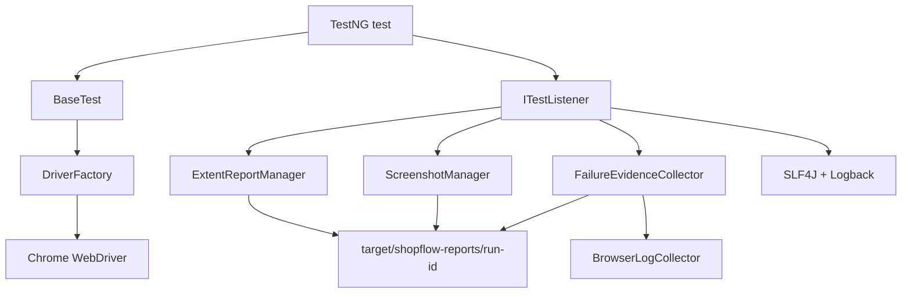

# Phase 8 — Reporting, Screenshots, Logging & Debugging

Yeh guide actual ShopFlow Phase 8 implementation explain karti hai. Normal tests green rehte hain; separate diagnostic suites jaan-boojhkar FAIL aur SKIP create karke reporting prove karti hain.

## Chapter 1 — Introduction to Test Reporting

Execution batata hai test chala; reporting batati hai kya chala, kitna time laga, kyon fail hua aur evidence kahan hai. QA engineer ki responsibility sirf green count nahi—result traceable, reproducible, privacy-safe aur stakeholder-readable hona chahiye. Real projects mein CI build ke saath HTML, XML, logs aur screenshots artifacts hote hain. Report business assertion replace nahi karta; woh assertion outcome ko explain karta hai.

## Chapter 2 — Selenium and TestNG Reporting Architecture



Page Objects browser behavior rakhte hain; tests assertions; BaseTest driver lifecycle; listener events; managers artifacts. Is boundary se future test automatically reporting paata hai aur Page Objects mein report calls nahi bharte.

## Chapter 3 — TestNG ITestListener

`TestExecutionListener` service registration se TestNG ko milta hai. Actual flow:

- `onTestStart`: driver-less discovery callback filter, suite initialize, safe unique invocation ID, Extent node, class/groups.
- `onTestSuccess`: duration calculate, PASS record, thread-local node clear.
- `onTestFailure`: driver fetch, screenshot, diagnostics, exception, URL/title/browser/console, FAIL.
- `onTestSkipped`: exact SkipException reason ke saath SKIP.
- `onStart/onFinish`: suite/test context counts log.
- `onExecutionFinish`: report ek baar final state tak flush; no real TestNG event ho to report create nahi.

Important line:

```java
Object instance = result.getInstance();
return instance instanceof BaseTest baseTest ? baseTest.getDriver() : null;
```

Yeh second browser create nahi karta. `result.setAttribute(...)` per-invocation identity store karta hai. DataProvider parameters report mein serialize nahi hote.

## Chapter 4 — TestNG Lifecycle and Listener Timing

Order normally hai: `@BeforeMethod` driver create -> `onTestStart` -> test -> success/failure callback -> `@AfterMethod` quit. Failure screenshot callback teardown se pehle aata hai, isliye live browser available hai. `alwaysRun=true` cleanup failure/skip ke baad bhi hota hai. Driver unavailable ho to evidence best-effort hai; original throwable kabhi replace nahi hota.

Surefire JUnit Platform TestNG engine discovery kuch driver-less preliminary callbacks deta hai. Phase 8 unhe real execution nahi maanta because `BaseTest.getDriver()` null hota hai. Actual browser callbacks hi Extent entries bante hain; isse duplicate nodes nahi hote.

## Chapter 5 — Selenium Screenshots

```java
TakesScreenshot camera = (TakesScreenshot) driver;
File source = camera.getScreenshotAs(OutputType.FILE);
Files.copy(source.toPath(), destination, REPLACE_EXISTING);
```

`OutputType.FILE` temporary file deta hai; `BYTES` direct byte array deta. `ScreenshotManager` safe filename, unique invocation ID, portable `Path` aur relative HTML reference use karta hai. Browser crash/session close/TakesScreenshot unavailable ho to empty result aata aur warning log hoti hai—test failure preserved rehta hai.

## Chapter 6 — ExtentReports Basics

`ExtentSparkReporter` HTML renderer, `ExtentReports` execution model, aur `ExtentTest` ek invocation node hai. `ExtentReportManager` document title/theme/timestamp, Java/OS/Selenium/suite metadata set karta hai. First live driver se runtime browser/version add hota hai. PASS/FAIL/SKIP callbacks exact status set karte hain. `flush()` execution finish par complete HTML likhta hai.

## Chapter 7 — Screenshot Attachments in HTML

HTML `index.html` run root mein aur image `screenshots/...png` mein hoti hai. Report ko relative path diya gaya:

```java
test.addScreenCaptureFromPath("screenshots/failure-id.png", "Failure screenshot");
```

Isliye folder move/archive hone par link saath rehta hai. Broken image debug: href inspect karo, path separators `/` confirm karo, image exists/size > 0 check karo, aur report folder ko incomplete copy mat karo. Controlled failure screenshot programmatically resolve aur visually open karke verify hui.

## Chapter 8 — Java Logging Basics

`System.out` level, class, timestamp, rollover aur centralized control nahi deta. SLF4J logger facade hai. Levels: DEBUG detailed diagnosis, INFO lifecycle, WARN recoverable limitation, ERROR genuine failure. Phase 8 structured messages use karta hai: `event=test_failed id=... durationMs=...`.

## Chapter 9 — SLF4J and Logback

SLF4J API `2.0.20`; single provider Logback Classic `1.6.5`. `logback-test.xml` console + rolling file `target/shopflow-logs/shopflow.log` configure karta hai. Pattern timestamp, level, logger, thread aur message rakhta hai. Maximum 5 MB per file, seven-day history, total 50 MB. Dependency tree mein one provider mila aur previous “No SLF4J providers” warning resolve hui.

## Chapter 10 — Failure Metadata

`FailureEvidenceCollector` timestamp, suite/test/class/method, exception type/message, bounded 30-frame stack, URL, title, browser name/version, screenshot relative path aur maximum 50 console records save karta hai. Credentials, cookies, headers aur parameters collect nahi hote. Common secret-like console values regex se redact hote hain. Page source intentionally dump nahi hota.

## Chapter 11 — Browser Console Logs

`ChromeOptionsFactory` existing password-manager preferences preserve karke `goog:loggingPrefs` browser log level ALL add karta hai. Failure par supported log types inspect hote hain. `LogType.BROWSER` unavailable ho to limitation line; available-but-empty ho to clear message. CDP dependency ya security policy change nahi ki gayi.

## Chapter 12 — Artifact Directory Management

```text
target/
├── shopflow-reports/<timestamp-uuid>/
│   ├── index.html
│   ├── screenshots/
│   └── diagnostics/
└── shopflow-logs/shopflow.log
```

`ReportArtifactManager` normalized Path, root-boundary validation, millisecond timestamp + UUID aur sanitized names use karta hai. Each JVM execution distinct run directory banata hai. Automatic historical deletion intentionally nahi; `mvn clean` target clean karta hai. Entire `target/` already `.gitignore` mein hai.

## Chapter 13 — DataProvider Reporting

Same method seven baar execute hota hai, so method name alone unique key nahi. Atomic sequence se `[invocation 00001]` ... generated safe IDs milte hain. Username/password/expected error parameters HTML mein serialize nahi kiye gaye. Actual isolated run: seven unique PASS nodes, credential literal occurrences zero, fresh browser teardown seven times.

## Chapter 14 — TestNG XML Integration

Listener `META-INF/services/org.testng.ITestNGListener` se register hai; XML suites mein repeated listener tag nahi, so duplicate registration nahi. Same mechanism targeted class, Surefire TestNG engine aur Maven Exec native XML par available hai. `AdvancedCases` classes explicit XML se aur original `*Test` default discovery se run hote hain. JUnit-only run lazy initialization ke kaaran HTML artifact nahi banata.

## Chapter 15 — Maven and Surefire Reports

Maven lifecycle compile/test/verify build status deta hai. Surefire XML machine-readable class counts deta hai. Native TestNG XML Maven Exec se `test-output/testng-results.xml` banata hai. Extent human-readable diagnostics deta hai. Counts semantics different ho sakte hain: configuration failure Extent mein standalone diagnostic node ban sakti hai while Surefire test/error classification alag ho. Source of truth ko hide nahi karna—systems compare aur difference document karo.

## Chapter 16 — Automated Failure Debugging

- `TimeoutException`: screenshot + URL + final DOM state/console; wait condition/locator inspect.
- `ElementClickInterceptedException`: screenshot overlay/popup prove kare; JS click mat lagao.
- `StaleElementReferenceException`: DOM replacement evidence, element re-locate.
- `AssertionError`: actual vs expected and business rule inspect.
- Browser crash: screenshot fail ho sakti hai, but exception + class/method/time retained.
- Driver null: setup/config failure separately logged; original failure retained.

Evidence-driven order: reproduce targeted -> exact line -> context/URL -> screenshot -> browser logs -> smallest fix -> module -> regression.

## Chapter 17 — Practical Failure Demonstration

`ReportingFailureDiagnosticCases` local `alerts.html` open karke intentionally wrong title assert karta hai. Yeh default 49 aur advanced 33 suites mein nahi hai. Explicit XML command genuine exit code 1 deta hai. Actual result: one FAIL, `AssertionError`, screenshot PNG, diagnostic TXT, FAIL HTML node and attachment. Teardown browser close karta hai. Is test ko pass banana objective nahi.

## Chapter 18 — Chrome Password Manager Case Study

Earlier symptom: Chrome “Change your password” warning automation controls ko interfere kar raha tha; Edge comparison helpful tha. Root-cause investigation ke baad Selenium-created Chrome options mein `credentials_enable_service=false` aur `profile.password_manager_leak_detection=false` preserve hue. Personal profile/account/global security change nahi hua. Phase 8 future recurrence par screenshot, current URL, console, browser version aur exception automatically dega; historical investigation se extra evidence invent nahi kiya gaya.

## Chapter 19 — Actual Framework Walkthrough

- `ReportArtifactManager`: run paths, directories, sanitized filenames; Java `Path`, record, synchronization.
- `ExtentReportManager`: Extent lifecycle, environment/runtime metadata, ThreadLocal current node, flush.
- `TestExecutionListener`: event-driven orchestration, status, unique invocation, filtering and logs.
- `ScreenshotManager`: standard Selenium screenshot and safe copy.
- `FailureEvidenceCollector`: bounded browser/exception metadata and TXT artifact.
- `BrowserLogCollector`: supported console logs, limits and redaction.
- `ReportingFailureDiagnosticCases`: isolated negative acceptance test.
- `ReportingSkipDiagnosticCases`: isolated `SkipException` classification test.
- `logback-test.xml`: console/file policy.
- Service-provider file: listener auto-registration exactly one strategy.

## Chapter 20 — SOLID and Reporting Architecture

Single Responsibility: listener coordinates, screenshot manager captures, evidence collector describes, artifact manager owns paths. Dependency boundary: tests expose read-only driver; reporting does not create drivers. Event-driven design TestNG callbacks consume karta hai. Logging infrastructure report logic se separate hai. Page Objects unaffected hain. Static manager one execution resource hai, global mutable WebDriver nahi. ThreadLocal only report-node association ke liye hai, parallel execution Phase 9 scope hai.

## Chapter 21 — Interview Questions

1. **ITestListener kya hai?** TestNG lifecycle event observer.
2. **Listener benefit?** Cross-cutting reporting without every test edit.
3. **Failure screenshot callback?** `onTestFailure`.
4. **Teardown timing important kyon?** Quit ke baad screenshot impossible.
5. **Driver listener ko kaise mila?** Test instance ke read-only `getDriver()` se.
6. **Static WebDriver kyon nahi?** Shared state, isolation and parallel hazards.
7. **PASS kab mark hota hai?** Actual `onTestSuccess` callback only.
8. **SKIP ko PASS bana sakte hain?** Nahi; status semantics corrupt hongi.
9. **ExtentReports kya hai?** Test execution model and reporter coordination library.
10. **ExtentSparkReporter?** HTML Spark renderer.
11. **ExtentTest?** One report test/invocation node.
12. **`flush()` purpose?** In-memory model final HTML mein write/update.
13. **Every event par flush?** Unnecessary I/O; finish par enough.
14. **Screenshot standard API?** `TakesScreenshot.getScreenshotAs`.
15. **Relative path benefit?** Portable complete report folder.
16. **Filename sanitize kyon?** Invalid separators/path traversal prevent.
17. **Screenshot capture fail ho to?** Original test failure preserve, warning log.
18. **DataProvider overwrite kaise prevent?** Unique invocation ID.
19. **Parameters HTML mein kyon nahi?** Password/PII leakage risk.
20. **SLF4J kya hai?** Logging facade/API.
21. **Logback kya hai?** SLF4J provider/implementation.
22. **Multiple providers problem?** Ambiguous binding and warnings.
23. **Useful log format?** Timestamp, level, logger/thread, context key-values.
24. **Console log capability?** Chrome `goog:loggingPrefs`.
25. **Browser logs universal?** Nahi, driver/browser dependent.
26. **Logs bounded kyon?** Report size/noise/security control.
27. **Page source capture kyon nahi?** Large and may contain sensitive data.
28. **Capabilities use?** Runtime browser name/version.
29. **Suite metadata kahan?** Extent system info and lifecycle logs.
30. **Surefire vs Extent?** Machine build report vs human diagnostic HTML.
31. **Native XML execution?** Maven Exec invokes TestNG main.
32. **Listener registration strategies?** Annotation, XML, service loader, programmatic.
33. **Duplicate registration symptom?** Same invocation multiple report nodes.
34. **Phase 8 strategy?** Single TestNG service-provider registration.
35. **JUnit reporting affected?** No; lazy TestNG report remains uninitialized in JUnit-only run.
36. **Controlled failure value?** Proves negative path/evidence, not just PASS path.
37. **Controlled failure normal suite mein?** Never; explicit diagnostic only.
38. **CI artifacts mein kya publish?** Report run folder, diagnostics, screenshots and native XML.
39. **Retry reporting fix hai?** Nahi; root cause mask kar sakta hai.
40. **Good reporting design goal?** Accurate, centralized, bounded, portable and privacy-safe evidence.

## Chapter 22 — Coding Exercises

1. **Basic listener:** `class L implements ITestListener { public void onTestSuccess(ITestResult r){ ... } }`
2. **Capture screenshot:** `File f=((TakesScreenshot)driver).getScreenshotAs(OutputType.FILE);`
3. **Unique file:** `String name=sequence+"-"+safe(method)+".png";`
4. **Copy screenshot:** `Files.copy(f.toPath(), target, REPLACE_EXISTING);`
5. **Create Spark reporter:** `new ExtentSparkReporter(reportPath.toString());`
6. **Create test node:** `ExtentTest t=extent.createTest(displayName, description);`
7. **Record PASS:** `t.pass("PASS | duration="+duration+" ms");`
8. **Record FAIL:** `t.fail(result.getThrowable());`
9. **Record SKIP:** `t.skip(result.getThrowable().getMessage());`
10. **Attach image:** `t.addScreenCaptureFromPath("screenshots/failure.png");`
11. **Capture URL safely:** `try { url=driver.getCurrentUrl(); } catch(RuntimeException e){ url="unavailable"; }`
12. **Runtime browser:** `Capabilities c=((HasCapabilities)driver).getCapabilities();`
13. **Portable run directory:** `Path run=Paths.get("target","shopflow-reports",runId);`
14. **Mask console secret:** `message.replaceAll(secretPattern,"$1$2[REDACTED]");`
15. **Controlled failure:** `Assert.assertEquals(driver.getTitle(), "Wrong", "Diagnostic failure");`

Practice solution pattern: code ko smallest responsible class mein rakho, IOException/browser exception best-effort handle karo, original assertion never swallow karo, and explicit test se output verify karo.

## Chapter 23 — Debugging Scenarios

| # | Symptom | Possible cause | Diagnosis | Fix | Prevention |
|---|---|---|---|---|---|
| 1 | HTML missing | listener not registered/no real event | service file and logs inspect | registration/resource fix | targeted PASS acceptance |
| 2 | Duplicate nodes | listener twice/discovery callbacks | compare native count and Extent nodes | one registration + driver-less filter | report count audit |
| 3 | Blank report | flush missing/too early | lifecycle logs and file timestamp | execution-finish flush | final report assertion |
| 4 | Screenshot missing | driver null/closed | callback order and warning log | capture before teardown | BaseTest contract |
| 5 | Broken screenshot link | absolute/wrong relative path | inspect HTML href and resolve file | run-root relative path | move folder test |
| 6 | Same image overwritten | method-only filename | compare DataProvider files | unique invocation ID | safe sequence/UUID |
| 7 | Failure shown PASS | wrong callback mapping | compare TestNG XML | only success->pass | controlled negative run |
| 8 | Skip shown FAIL | throwable handled generically | inspect `onTestSkipped` | dedicated skip handler | controlled SkipException |
| 9 | No browser logs | capability/type unsupported | available log types | enable Chrome logging; graceful message | browser limitation docs |
| 10 | SLF4J warning | no/multiple provider | Maven dependency tree | one aligned Logback provider | dependency audit |
| 11 | Secret in HTML | parameters/logs serialized | search artifacts for known test secrets | omit params/redact logs | security scan |
| 12 | Empty report on JUnit | eager TestNG initialization | before/after folder count | lazy init on real TestNG event | isolated JUnit verification |

## Chapter 24 — Complete Revision

Listener cheat sheet: start creates safe unique node; success/pass; failure/evidence/fail; skip/reason; finish/flush. Selenium cheat sheet: `TakesScreenshot`, `OutputType.FILE`, `HasCapabilities`, `manage().logs()`. SLF4J cheat sheet: facade + one provider; parameterized logging; levels; no secrets. Extent cheat sheet: Spark -> ExtentReports -> ExtentTest -> status/media -> flush.

Important commands:

```powershell
$maven = Join-Path $env:TEMP 'shopflow-maven-3.10.0\apache-maven-3.10.0\bin\mvn.cmd'
& $maven clean test
& $maven verify
& $maven -DskipTests test-compile '-Dtestng.suite=testng-smoke.xml' exec:java
& $maven -DskipTests test-compile '-Dtestng.suite=testng-advanced.xml' exec:java
& $maven -DskipTests test-compile '-Dtestng.suite=testng-regression.xml' exec:java
& $maven '-Dtest=DataDrivenLoginCases' test
& $maven '-Dtest=PriceCalculatorJupiterSpec,InputValidatorJupiterSpec' test
& $maven -DskipTests test-compile '-Dtestng.suite=testng-reporting-failure.xml' exec:java
& $maven -DskipTests test-compile '-Dtestng.suite=testng-reporting-skip.xml' exec:java
```

Final coding tasks: report retention configurable banao; CI mein report folder publish karo; parallel phase mein invocation/report context strategy re-evaluate karo; setup-failure fixture add karke configuration semantics compare karo.

Phase 8 checklist: Extent HTML, PASS/FAIL/SKIP, screenshot attachment, diagnostics, browser console, runtime metadata, SLF4J/Logback, DataProvider uniqueness, native/default execution, privacy scan, controlled negative tests, complete regression, docs. Phase 9 parallel/CI ka kaam hai—Phase 8 mein start nahi hua.
