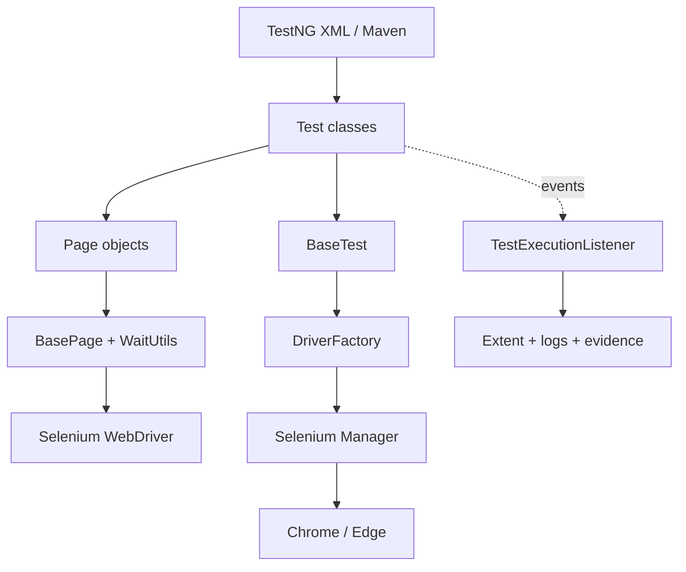
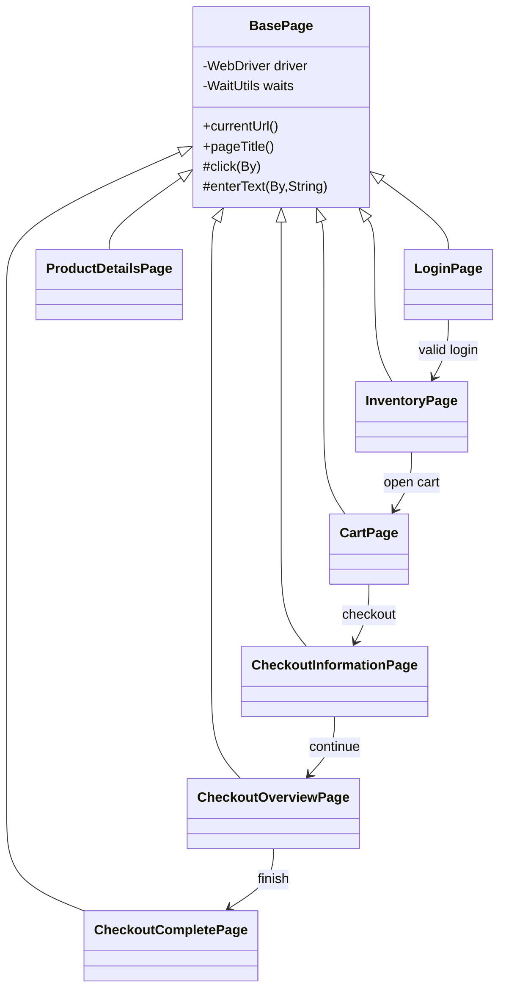
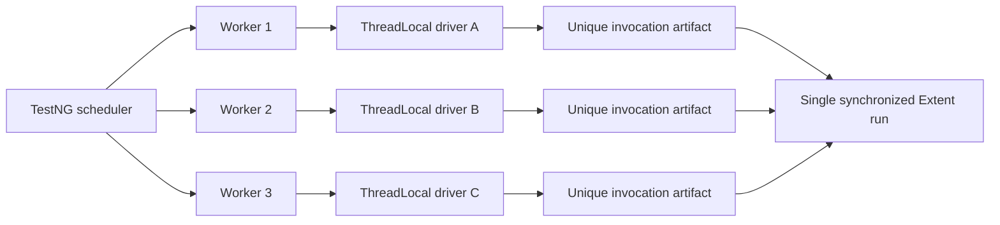
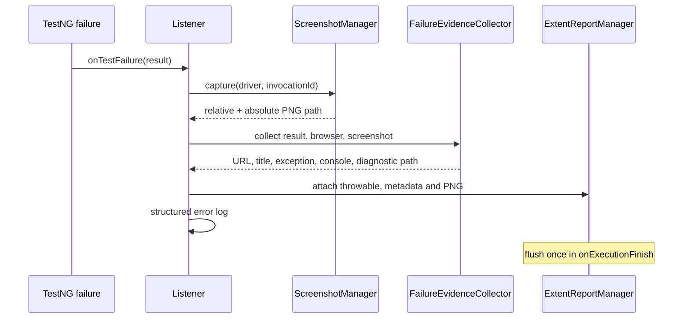

# Architecture

## 1. Layered view



Tests express intent and assertions. Page Objects own locators and browser interactions. Core classes own configuration and browser lifecycle. Reporting observes execution without changing pass/fail decisions.

## 2. Driver lifecycle

```mermaid
sequenceDiagram
  participant N as TestNG
  participant B as BaseTest
  participant F as DriverFactory
  participant D as DriverManager
  participant T as Test method
  N->>B: @BeforeMethod(browser, headless)
  B->>F: createDriver()
  F-->>B: ChromeDriver or EdgeDriver
  B->>D: setDriver(thread-local)
  B->>B: navigate initialUrl
  N->>T: execute
  T->>D: getDriver()
  N->>B: @AfterMethod(alwaysRun=true)
  B->>D: quitDriver()
  D->>D: driver.quit(); ThreadLocal.remove()
```

The guard rejects a second driver on the same thread. Cleanup runs even after failures and removes the reference to prevent cross-test leakage.

## 3. Page Object collaboration



Page methods return the next page type, making navigation readable while assertions stay in tests.

## 4. Parallel isolation



There is no static shared WebDriver. Immutable datasets, atomic invocation numbers, per-thread Extent nodes and unique filenames make three-worker execution safe.

## 5. Failure evidence flow



## Package responsibilities

| Package | Responsibility |
|---|---|
| `core` | typed configuration, browser creation, ThreadLocal ownership, parallel suite tuning |
| `pages` | stable locators and user actions; `pages.advanced` wraps local fixtures |
| `tests` | scenarios and assertions; diagnostics are isolated under their own package |
| `reporting` | listener, Extent lifecycle, screenshots, browser logs and diagnostics |
| `utils` | explicit waits, money parsing and fixture URI/file helpers |
| `models` | immutable checkout input |
| `learning` | intentionally separate JUnit/TestNG examples |

## Reliability and design choices

- Explicit waits describe observable state. Mixing implicit waits is prohibited.
- Each method gets a fresh browser, trading some speed for deterministic state.
- Selenium Manager resolves drivers; binaries are not checked in.
- Chrome/Edge options are fresh per session. Password manager preferences do not modify a user's profile.
- SauceDemo business tests and advanced fixture tests are separate suites.
- Money uses `BigDecimal`, not binary floating-point.
- Failure capture is best-effort and must never replace the original assertion error.

## Known architectural debt

`DriverFactory` imports `ChromeOptionsFactory` and `EdgeOptionsFactory` from the `tests` package. It works and is covered by all browser runs, but moving these two factories into `core` would improve dependency direction in a future, separately reviewed change. It was not refactored during the final audit because there was no functional defect.

